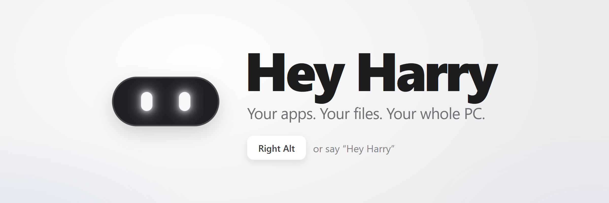
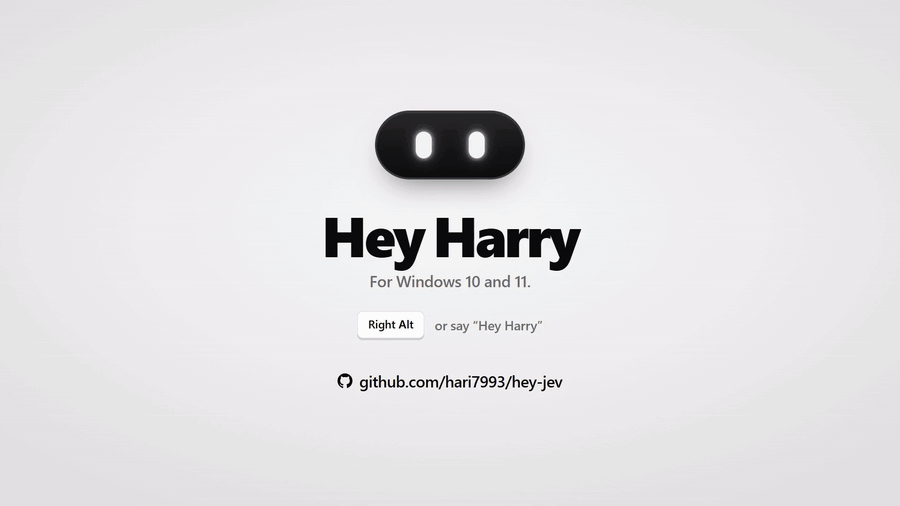
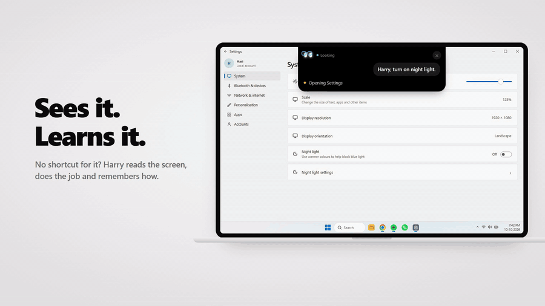

<p align="center"></p>

<p align="center">
  Say <b>"Hey Harry"</b> or hold <kbd>Right Alt</kbd>, ask for what you need, and let go.<br>
  Harry opens and arranges your apps, plays music, reads your screen and gets it done, on Windows 10 and 11.
</p>

<p align="center">
  <b>🧠 Learns as you use it</b> &nbsp;·&nbsp; <b>⚡ Fast</b> &nbsp;·&nbsp; <b>🆓 Runs on free models</b> &nbsp;·&nbsp; <b>🪟 Made for Windows</b>
</p>

## Quick install

```
git clone https://github.com/hari7993/hey-harry.git
cd hey-harry
powershell -ExecutionPolicy Bypass -File setup.ps1
```

Needs Windows 10 or 11, Python 3.10 or newer, a free [Fish Audio](https://fish.audio/?fpr=henryk) key for her voice, and a key for one answer model (Kilo's and OpenCode Zen's free models cost nothing). [Full setup](#what-you-need)

## What she does

- **Learns.** Ask for a task none of her steps covers, like "turn on night light", and she does it on the screen, checks it worked, and keeps the steps. Next time it runs with no model at all.
- **Instant commands.** Opens apps, puts windows where you say, plays music, sets timers and presses shortcuts on your PC in about half a second, with no AI.
- **Sees your screen.** Ask about anything on it. "Where do I click?" rings the spot and draws each step on your screen.
- **Calendar, Spotify and email.** Reads and adds events, plays playlists on Spotify, and writes a reply into the email in front. She never sends it.
- **Background helpers.** Give a helper a name and a job, talk to it while it works, and watch it in a live mini view.
- **Meeting notes.** Notes, answers and a recap in any call app. The audio never leaves your PC.
- **Remembers you.** Say "remember…" and she knows it from then on. Teach her a phrase once and it becomes a routine.
- **Builds into herself.** "Build yourself a way to..." and she codes it, tests it and restarts with it, on the model you pick. An error of her own she fixes the same way, and a crash she starts again from.
- **Your PC from your phone.** Your own Telegram bot: text or voice notes, with Yes and No buttons for anything risky.
- **Dictation.** "Hey Harry, transcribe" types your words where your cursor is, with the "um"s taken out.
- **Free models, or Claude.** Runs on free models with no billing, or on Claude Haiku 5.5 with your own Anthropic key.
- **Private and safe.** Listening and speech-to-text run on your PC. Messages, deletes and installs wait for your yes, and she never pays for anything.

<p align="center">
  
  
  
  
  
</p>

<br>

<p align="center">
  <a href="docs/harry-explainer.mp4"></a><br>
  <sub>▶ <a href="docs/harry-explainer.mp4">Watch it with sound</a> (1 minute)</sub>
</p>

<br>

## Just ask

| You say | Harry |
|---|---|
| *"Chrome on the left, Notepad on the right."* | Puts both windows where you said, with no AI. |
| *"Open Spotify."* · *"Louder."* · *"Scroll down."* | Done on your PC in about half a second. |
| *"Find my notes about the Tokyo trip."* | Searches inside your files with Windows Search. "Open the first one" opens it. |
| *"Where do I click to turn on Bluetooth?"* | Rings the spot on your screen and draws each step. She never clicks for you here. |
| *"Turn on night light."* | Does it in Settings, checks the switch is on, and learns how for next time. |
| *"Message Mum on WhatsApp: running late."* | Reads it back and sends it only when you say yes. |
| *"Reply saying sounds good, see you at 7."* | Writes it into the email in front. You press Send. |
| *"Move lunch with Sam to 4."* | Reads the change back and moves it on your yes. Adding an event is immediate. |
| *"Take notes in this meeting."* | Writes down what's said, answers "what did they just ask?", and saves a recap. |
| *"Make a helper called Researcher to find budget laptops."* | Works in the background in a live mini view. "Researcher, look at battery life too" steers it. |
| *"Play lofi beats on Spotify."* | Finds it in Spotify, presses play, and checks it's playing. |
| *"Order biryani on Zomato."* | Opens Zomato, searches and shows you the choices. You pick and pay. |
| *"When I say work mode, open Gmail and set the volume to 30."* | Remembers it. Next time, "work mode" does it all. |

<p align="center"></p>

## Safe by default

She does what she hears, so there are limits whoever asks. Messages, deletes, installs and shutdowns wait for your yes, with what would go out read back in full, and she never pays or checks out. Typing and key presses never go to command windows, the Run box or Start, and what web pages and messages say is information, never orders. She leaves payment pages and password managers to you and never types a password. Speech-to-text runs on your PC, so what the mic hears stays here. Screenshots go to the model only for a look or a task, or a glance while she watches your screen, and they're never kept. More in [Safety](#safety).

<details>
<summary><b>How you talk to her</b></summary>
<br>

The switch at the top right of her window picks the way. **Hold Right Alt:** hold the key, talk, let go. Harry swallows the key, so the app in front doesn't open its menu. **Hey Harry:** she's always listening. Say "Hey Harry", "Harry" or "Jarvis" and what you want, or just what you want when Answer without her name is on in Settings. For 8 seconds after she answers, the next thing you say needs no name: "open YouTube", then "scroll down", then "close it".

Tap Right Alt twice anywhere and a typing box opens near the top of the screen. What you type goes as if you'd said it with her name. "Stop", her name or Right Alt stops a task part way. Her island at the top of the screen shows your words as you talk, what she's working on (with Stop, Approve and Deny) and her answer.

</details>

## Models and billing

Any model on any provider in Settings > Answer model can be her answer model, the way Hermes Agent and OpenClaw pick one: OpenCode Zen, Kilo, OpenRouter, Anthropic, OpenAI, Google Gemini, xAI, Groq, DeepSeek, Mistral, Cerebras, Together, Nous Portal, Hugging Face, Moonshot, or Ollama and LM Studio on this PC. Free ones say so in the list. Any other is billed per request to your own account with that provider, at its prices, and only once you've picked it and saved its key.

With the key, Haiku plans and answers, and also gets the screenshots, the day's summary and her learning. When Haiku is slow, a free model gets a second try: Kilo's `nvidia/nemotron-3-ultra-550b-a55b:free`. Without the key, she uses free models only, and screenshots go to Kilo's free `nvidia/nemotron-3.5-super-vl:free`, which reads pictures.

Free models are free for a limited time, and they can end without notice:

- If the free answer model ends, the simple commands still work, since they never need it. For everything else she says her brain isn't answering, and the window says why. Settings > Refresh lists the free models that work now.
- Fish's `s2.1-pro-free` is free until the end of November 2026. After that her voice stops unless Fish keeps a free model.

In October 2026 OpenCode's `space-bunny-free` stopped answering (410 Gone), Kilo dropped Ling 3.0 Flash Sante, and Kilo's Nemotron 3 Super returned 404, so the free models above are the ones that still answered. OpenCode keeps most of its other free models for its own coding app ("OpenCode's free tier can only be used from within OpenCode").

## What it can do

- Apps: open, close, minimise or switch to anything in the Start menu, and Windows' own tools and Settings pages that aren't in it: "open Device Manager", "open Windows Update", "camera settings", "Wi-Fi settings", "Control Panel". Only those on a fixed list, and Settings pages, are opened (`WINDOWS_PAGES` in `winplatform.py`), never Run, the registry, Task Scheduler or a command window. "What apps do I have installed?" is answered from the Start menu. Close works the way clicking X does, so apps can still ask about unsaved work. Apps that only drop to the tray (Spotify, Slack, Discord) are then ended.
- Windows, put where you say: "Chrome on the left, Notepad on the right", "put VS Code on my big screen", "Spotify full screen on the laptop", "Notepad in the middle", with no model when every app named is one she knows. A side is left, right, top or bottom; a screen is the laptop's own, the monitor (the biggest other one), "the other screen" or a display's name ("the Dell"), else the one the window's on. An app that isn't open is opened first. Said another way, the model plans the same step.
- Websites and search: "open YouTube", "open github.com in Edge", "google the weather in Delhi", "search lofi music on YouTube".
- Food and shopping: "order biryani on Zomato" opens Zomato, searches for biryani and shows you the choices, and Swiggy, Amazon or Flipkart the same way. You pick, pay and place the order yourself: she never checks out or pays (`ORDER_STEPS` in `siri.py`). Until 27 October she only opened the site and said "You'll have to pick the biryani and place the order yourself".
- Music and video: "play Arijit Singh songs" plays YouTube's top video for it. Play, pause, next and previous work on whatever is playing, YouTube in the browser or Spotify. On Spotify, "previous" partway through a song goes back a song, not to its start. VLC 3 isn't in Windows' media controls, so when nothing there is playing and VLC is open, she brings it to the front and presses its own keys: pause, next and previous while VLC is playing, and play when nothing else is in the media controls. Before a new video starts, the last one is paused, so two don't play at once. The browser is brought to the front, since Chrome holds a video back while its window is hidden behind others. She hears you over the video, see Echo cancelling below.
- The app in front: "scroll down", "scroll to the top", "new tab", "close this tab", "go back", "refresh", "make it full screen" on YouTube, and other shortcuts.
- Keyboard shortcuts, pressed on the PC with no model: about 160 of Windows 11's own and those of Chrome and Edge, File Explorer, YouTube, Word, VS Code and Notepad (`shortcuts.py`, from Microsoft's, Google's and YouTube's own lists). "Show the desktop", "snap this window left", "open clipboard history", "emoji panel", "new virtual desktop", "reopen the closed tab", "turn on captions", "rename this file", "open the command palette". The app in front decides: "new tab" is Chrome's or File Explorer's, "full screen" is YouTube's own on YouTube. The Windows key is only ever pressed for one of these, never for a plan the model made. Heard without her name, only ones that show or move things, never paste, undo and the like. Nothing that deletes, signs out or runs things is in the list.
- Writing: "open Notepad and write today's date", "write a short email saying I'll be late". The text goes where your cursor is.
- Volume, mute, a volume level (in digits or words), an app's own volume, dark or light mode, night light, lock or sleep the PC, or shut it down or restart it after a yes.
- Brightness, Wi-Fi, Bluetooth, the mic and where the sound goes, switched straight away with no Settings window, from [Tomte](https://github.com/xditya/tomte-windows) (MIT, `src/Tomte.Core/Device`): "increase brightness", "brightness 60", "dim the screen", "turn on Bluetooth", "turn off Wi-Fi", "mute my mic", "switch the sound to my JBL speaker". She says what each one is now ("Bluetooth's already on."). Brightness is the laptop's own screen only, through WMI; an external monitor needs DDC/CI, which she doesn't do. Wi-Fi and Bluetooth go through Windows.Devices.Radios, and if Windows won't let her, their Settings page opens instead. A sound output is picked by its name ("JBL", "buds"), and if two are as near ("speaker", with the laptop's and a Bluetooth one) she names them and asks. Before Wi-Fi goes off she says so, since her voice comes from Fish online; "turn on Wi-Fi" works with no internet, with no model. A muted mic is muted for her too, so unmute it from your phone or in Windows; she only mutes it when your words say "mic". Said without her name, the words have to name what changes. On 25 October "Increase brightness" went to a task in Settings, which pressed Win+A and stopped. "Light mode" while Windows is light already and Night light is on turns Night light off, since its warm screen is what looks dark ("light mode" said four times on 25 October changed nothing). With both off she says so, and that apps like Chrome have a dark theme of their own in their settings.
- Timers and reminders: "set a timer for 5 minutes", "remind me in 20 minutes to call Mum", "remind me every hour to drink water", "how long is left?", "cancel the 5 minute timer". Timers, and one-off reminders due within 12 hours, count down live in the window, and she tells you when each is done. "Cancel the timer" cancels only timers; "cancel my reminders" or "stop reminding me to drink water" names the reminders and cancels them after a yes.
- Questions and chat: "what's the capital of Japan?", "and Australia?", "hello", "thanks".
- Several things in one go: "open Chrome and search for career ID".
- Remembering: "remember that my website CareerID is careerid.in", then later "open CareerID". "What do you remember about me?", "forget that ...". See Memory below.
- Looking back: "what did we talk about yesterday?", "what was that video I played?".
- The PC: "check the storage of C drive", "is my laptop charging?", "how much RAM am I using?", "what's using the CPU?", "am I online?", "how long has the PC been on?". Simple ones are answered on the PC straight away.
- Browser profiles by name: "go to my Harish profile", "open Gmail in my Work profile". She reads Chrome's, Edge's and Brave's profile list, and when Chrome starts with nothing open she uses the last profile, so its profile picker doesn't get in the way.
- A hello when you sign in or come back to the laptop, see Starting with Windows below.
- The screen: "what's on my screen?", "read this page to me", "click the sign in button", "play the video about biryani", "search for lofi music in this box". See Vision below.
- The world: "who directed Iron Man 2?", "what's the latest news?", "will it rain tomorrow?", "what's the weather like in Delhi?". See The internet below.
- Research: "research the best budget phones in India under 20,000". She looks into it in the background, reads a few pages, tells you when she's done and saves a note. "Make a note: ...", "open my notes".
- A to-do list: "add milk to my to-do list", "what's on my to-do list?", "cross off milk", "I've done the dishes", "remove pay rent from my to-do list", "clear my to-do list" (after a yes). It's kept on this PC in `%APPDATA%\Hey Harry\todo.json` (`todo.py`) and shown in the To-do tab, where you can add, tick off, put back, remove and fix them. Without her name she reads it and ticks things off when you say so in so many words, but never adds or clears.
- Your files: "find my resume", "where's the invoice PDF?", "find my screenshots", "open the CareerID offer letter", then "open the second one" or "show me where it is". She asks Windows Search's own index (`filesearch.py`), by file name only, in your own folders and on D:, not AppData or a program's packages, so it takes under a second. Your phone's files from Phone Link only when you say "on my phone". She opens documents, pictures, videos, songs and zip files; a program, script or shortcut she found only gets its folder opened with it picked out, so a name heard wrong never runs anything. She only opens a file she just found and told you about. A folder Windows doesn't index won't show up (Settings > Searching Windows).
- Messages: "any new messages?" reads what came in on WhatsApp, Teams, Messages and so on. See Heads-ups below.
- Routines: "when I say work mode, open Gmail in my Work profile and set the volume to 30", then just "work mode". See Skills and learning below.
- Newer skills: where to click, ringed and drawn on your screen; a calendar; Spotify playlists; named helpers you can talk to while they work, with a live view of them; a reply written into the email in front; meeting notes with a recap; and files found by what's inside them. See Newer skills below.

Hide works like minimise, since Windows has no hide.

### Newer skills

Added on 28 October 2026, done the Windows way (`extras.py` joins them to her turns). Each is said plainly with her name and needs no model to start; said another way, the model plans the same step.

- **Where do I click.** "Where do I click to turn on Bluetooth?", "show me how to change my wallpaper", "where's the export button?", "explain this page to me". She looks at the window in front (its controls by UI Automation, and a screenshot), asks the model what to point at, and draws it: a ring round each thing to click, numbered, a line from one to the next, a box round an area, a line under words to read, and a caption, each drawn on like a pen, with her saying each step as it appears (`showme.py`, `overlay.py`). She never clicks for you here. When more only comes after your click, like a menu opening, she watches for the click and shows the next part, up to 6 looks. Esc or "stop showing me" clears it. The drawing never takes a click or the focus and is left out of her own screenshots. Not on payment or password pages, and never a password box.
- **Calendar.** "What's on my calendar tomorrow?", "what's my next meeting?", "am I free at 5?", "when is my dentist appointment?", "add lunch with Sam tomorrow at 1", "put a meeting with Ravi on Friday at 3 PM for an hour", "move lunch with Sam to 4", "cancel the dentist" (`agenda.py`). Her own events are kept in `%APPDATA%\Hey Harry\calendar.json`. Moving or cancelling one is read back and done only on your yes. She says each event 10 minutes before it starts, and today's events are in her briefing. To read your Google or Outlook calendar too, copy its private iCal address (Google Calendar: Settings, your calendar, "Secret address in iCal format") and type "add my calendar" followed by the address in her typing box, or send it from your phone. She reads it every 10 minutes, keeps a copy for when you're offline, and never shows the address to a model or writes it in her log. She doesn't change those calendars: for one of their events she opens that day in Google Calendar, and "put it in my Google calendar" opens a new event filled in for you to save. Windows' own calendar store is only open to packaged apps, so the iCal address is the way in. "How do I connect my Google calendar?" explains it, "disconnect my calendars" stops it.
- **Spotify.** "Play lofi beats on Spotify", "play the playlist Discover Weekly on Spotify", "play my liked songs" (`spotify.py`). Windows has no AppleScript, so she opens Spotify's own search, presses the play button of the best match by UI Automation, and checks Windows' media controls that it's playing; if no button fits, she does it as a task in the app, which she then learns. Without the Spotify app she offers to install it (looked up and asked about, as any install), or "play it on Spotify web" plays it on Spotify's website.
- **Named helpers.** "Make a helper called Researcher to find the best budget laptops under 50,000", then "Researcher, look at battery life too", "tell Researcher to stick to Lenovo", "how's Researcher doing?", "what are my helpers doing?", "stop Researcher" (`helpers.py`). A helper is one of her background jobs with a name. What you tell a running one reaches it on its next round, and when it's done she says so by its name.
- **Live view of background work.** While a helper or another background job runs, a small card in the bottom-right corner shows each one, what it's doing now, and a live picture of the window it works in, from Windows' own window thumbnails, so you can watch it behind your other windows (`jobview.py`, `cards.py`). Click one to bring its window to the front; the x puts the card away till the next job. "Hide the live view" turns it off, "show me the mini view" back on. It's left out of screenshots and screen shares.
- **A reply in the email in front.** With Gmail, Outlook (on the web, classic or new), Yahoo, Zoho, Proton or Thunderbird in front: "reply saying sounds good, see you at 7" puts your words in as you said them; "write a reply saying yes but ask to move it to Friday" has the model write it from the email on the screen, in your voice, with [ ] where it needs something only you know (`drafts.py`). She opens the reply box with its Reply button if it isn't open, puts the reply in at the cursor, and leaves it. She never sends it: you read it and press Send. Numbers of 4 digits or more in the email are masked before it goes to the model.
- **Meeting notes.** "Take notes in this meeting" (or "start meeting notes", "record this call"), then "what did they just ask?", "what should I say?", "what have we decided so far?", and "stop the meeting notes" (`meeting.py`, `loopback.py`). She hears you through the mic and the others through what the PC plays (WASAPI loopback of the speakers or headphones, so any call app works), cuts it into what one person said at a time with Silero VAD and writes it down with her own speech-to-text. The audio never leaves the PC and isn't kept. While notes are on she only answers to her name. A card in the top-right corner shows the last thing said, the notes so far, and, when someone asks you something, what you could say; it's left out of screen shares. Every two minutes the text so far goes to the model for running notes, and at the end for a recap: a summary, what was decided, who's doing what, and what's still open. Each meeting is saved as a Markdown file with its whole transcript in `%APPDATA%\Hey Harry\meetings`; "open the meeting notes" opens the last one. Notes stop by themselves after 15 minutes of quiet. Recording people can need their consent where you live, and she mentions that the first time.
- **Files by what's in them.** "Find my notes about the Tokyo trip", "which document mentions invoice 4521?", "search inside my files for 'quarterly targets'" (`filecontents.py`). The same Windows Search index as finding files by name, asked for the words inside documents, PDFs and slides in your own folders, so it answers in about a second. Build output and logs go to the end of the list. "Open the first one" works after it. The model is only ever told names, folders and dates. Windows only looks inside files in the folders it indexes (Settings > Searching Windows).

### Vision, and tasks she learns by doing them

When you ask about the screen, or for a task in an app that none of her steps covers ("turn on night light", "send a mail to ..."), she says it back first ("Okay: turn on night light.") and then does it a few steps at a time (`agent.py`). She reads the window in front by Windows UI Automation: its buttons, boxes, switches and links, by name. That goes to the answer model, which says what to click, fill in or press next; she does it and looks again. A screenshot goes with every look, as [OpenLive](https://github.com/katipally/openlive)'s agent sends one with the controls each time, shrunk to 1280 pixels wide, to a model that reads pictures (Claude Haiku with your Anthropic key, else Kilo's free Nemotron 3.5 Super VL): pages drawn in a canvas, or whose controls don't say what's in them, were done blind before. A task gets up to 30 rounds, 30 screenshots and 5 minutes, and stops when three looks in a row show nothing changed. Plain "click ..." asks go straight to the button by name.

From OpenLive's agent too (Apache-2.0, its rules put in her own words in `AGENT_PROMPT`): look first and act on what's there now, open or switch to the app before working in it, and check before saying it's done. She switches between windows that are already open ("copy the total into Excel" goes to the Excel you have open, not a new one), and a window that comes up by itself while she works, like one she opened coming up late, is looked at and worked around. It used to stop her with "You're using the PC, so I've stopped", every time from 22 to 25 October.

Keys the answer model picks to do something in an app are never pressed blind any more (`checked_in_app` in `siri.py`). On 26 October "open recorder and record my voice" was planned as opening Sound Recorder and pressing Ctrl+R: the keys went nowhere, she said "I've started recording your voice" anyway, and when told it hadn't, pressed Ctrl+R again into a microphone permission prompt and went quiet. Now the app is opened as planned, and the rest is a task on the screen, with the keys as a hint: she looks at the window with a screenshot, does it, and says it's done only once code sees it on the screen (a Stop recording button, say). If something's in the way, like that prompt, she says what. Keys you name yourself ("press control s"), and keys in a browser, are pressed as planned.

Once it's done, and code has checked on the screen that it is (the switch is on, the mail's gone), she keeps what she did as a procedure, written by code and never by a model: "Okay, night light's on, and I've learned how." Next time the same words do it with no model at all, if they asked for just that task: not words that asked for more ("night light and open Gmail"), point back at an earlier turn ("turn it on"), don't say the task itself ("switch on", "do what he asked"), or came after she read a page or a message; the planner can still start it by name. When a task has things that change, like who a mail is to and what it says, those become slots, kept without the values, and the planner fills them from your new words in its one call, put its own way if need be: the procedure then types them in itself. Switches are kept with the state they were set to, so a switch that's already on is left on, and a button named for what it does next that was pressed already (Settings' "Turn on now", now "Turn off now") means it's done already, not that a step stopped working. Typing goes in at the cursor, adding to what's in the box. A task about whichever one is newest ("the latest mail", "my new mail", "the one that just came in") or what's on the screen isn't learned, and a mail row, a file, a list item your words didn't name, or a control with a twin by the same name, is kept to be found by sight, never by what it said this time. If a step stops working (an app moved its button), she works that bit out again from where it stopped, with a screenshot, and keeps the mended version; after three failures in a row she puts it away and works it out afresh next time. "Forget what you just learned" takes a new one back.

Limits: screenshots go to the model only for these asks, never otherwise, and are never kept. Her popup is left out of them. A first look at a window the task doesn't name sends only its title, so your bank isn't read out to the model when you ask for night light. Without her name she only does a task or looks at the screen when your words plainly ask for one ("turn on night light", "select smile emoji", "enable light mode", "open the second video", "open the link", "summarize that", "what's on my screen?"), she looked in the last minute, it's right after she answered and you're carrying on what you asked her ("on Amazon Music" after "play Lovely"), or Haiku, told the words were overheard, still took them as said to her and planned the task. From 21 to 25 October all 13 plans let go after Haiku had planned them were Hari's own requests ("Open settings and Windows update", "Can you summarize that", "Open the apply link"), so that's trusted now; typing and key presses still need words that ask for them. Anything else is let go quietly, never asked about. If she'd already said "One moment" to it, she says she's left it rather than going quiet. She no longer asks "Should I look at your screen for that?" or "Should I ...?" first, nor before a task heard less than 90% surely: on 8 to 21 October those were 65 questions, mostly about room talk. She learns from tasks you plainly asked for: by name, in so many words, or with a yes to her question. Only the very sensitive wait for your yes (your call, 31 October: "only high sensitive places"): sending, posting, commenting or replying, paying, buying or placing an order, deleting for good, installing, shutting down or restarting, and giving someone access. Removing, clearing, submitting, confirming, accepting, blocking, reporting, signing out and the like go ahead, and on a site your words named she no longer asks before each click after reading its page (a link to a site you didn't name still asks). A send waits for your yes to her own question with what it would send read back in full (what she typed, what a web address fills in, like a Gmail compose link's to, subject and body, and for a send what's in the window itself, like a new mail a link opened already filled in) and every address it goes to spelled out. A mail goes only to an address you said, now or a turn or two before, or one she remembers, unless you asked her to reply, and a send whose window she can't read is left to you. One yes is for one press: OK, Enter or Y on a "Delete these items?" box asks again, and so does Enter after typing on any page, whether or not she can read which site it is. She leaves payment pages and password managers to you, and on a sign-in page (Settings' "Sign-in options", a site's "Log in") she clicks but never types a password, a code or a card number. She never types or opens an address, link or number you didn't say, opens a site you didn't name only after asking, doesn't drive chat apps or chat sites (WhatsApp and Telegram have their own messaging), including one installed from its site as an app, only clicks in the window she's working in, and never clicks or types in command windows, the Run box or Start. "Stop", her name or right Alt stops a task part way, and so does "stop" from your phone, and the rest of what you asked for with it. Said out loud that needs Parakeet or Nemotron (see Talking over her); with Whisper, right Alt. Untick Let her see the screen in Settings to turn it off.

### Her own browser

Jobs on websites happen in a Chrome of her own, out of your way, never on your screen, the way [OpenMuse](https://github.com/CopilotKit/openmuse)'s agent works in its own browser. "Post on LinkedIn that I'm excited about my new project" or "add paneer tikka and a dal to my Zomato cart" becomes a job in the background in her browser, and you go on using the PC: your mouse and keyboard are never touched and her window never comes up. A task you ask to see ("show me my LinkedIn notifications", "... on my screen") stays on your screen as before, and so does anything about what's on your screen now.

You sign her in yourself. "Show me your browser", or "sign in to LinkedIn in your browser", puts her browser in front of you (or press Show it in Settings > Her own browser); sign in, then say "hide your browser". Her sign-ins stay in its own profile, `%LOCALAPPDATA%\Hey Harry\Browser`, apart from yours, so she's still signed in tomorrow. She never types a password or a code: a site that wants her to sign in again, or a "verify you're human" check, is left to you, and she says so. While you have her browser in front, her jobs in it wait, so your clicks and hers never mix.

Every rule of a task on your screen holds in her browser too: what she'd post, send, pay or delete waits for your yes with what it says read back, a page on a site you didn't name asks before each step, chat sites and payment pages are left to you. From OpenMuse's browser worker as well: she opens public sites only, never this PC or your home network (a router's or a printer's page), a page's own pop-up questions are answered no, and nothing is downloaded.

**Watching it and taking over.** A job working in her browser has a live picture of its page on its card in the corner of your screen, Windows' own, which costs nothing to draw though her browser is off your screens; click the card to have her browser in front of you. From your phone, "show me your browser" on Telegram (or "open Zomato in your browser") sends you a picture of her page with each control numbered and a button for each number: tap one and she clicks it, Type, Scroll and Back do what they say, and the picture changes in place as you go, as OpenMuse's Take control lets you tap to click. Only your Telegram account's taps reach it, her jobs in it wait till you tap Done (or 5 minutes without a tap), and a password is never taken over Telegram: sign in at the PC.

It's Chrome if you have it, else Edge, started when a job needs it and closed 2 minutes after the last one: about 260 MB while it works, nothing after. It's driven over a pipe only she holds (Chrome's `--remote-debugging-pipe`), never a network port, so no other program on the PC can drive it or read its sign-ins. Sites can tell it's driven by a program (`navigator.webdriver`), and it's never disguised. "Close your browser" closes it; "don't use your browser" (or unticking Her own browser in Settings) puts her jobs back on your screen. `herbrowser.py`.

### Watching your screen

Since 27 October 2026 she keeps an eye on your screen all the time, the way someone beside you would (`screen_watch.py`). Every few seconds she reads the window in front, on this PC: which app, its title, the site, and the words on it, by Windows UI Automation, as she reads a window for a task. She keeps the last ten minutes of where you've been. Reading costs nothing online. What's on the screen goes to the model with whatever you ask her, so "what does this error mean?", "summarise this", "what was I doing before lunch?" or "reply to that" know what you're looking at without your saying.

Every few minutes while the screen changes, and at once when something like an error, a warning, a crash or a meeting reminder comes up, she glances at it: a screenshot of the window in front and its words go to the model that sees, which says whether anything there needs you. If something does, she says so in a sentence once she's free ("The VLC install failed with error 1603."). Most glances find nothing and she says nothing. At most 12 an hour, never while you're away from the PC (five minutes without the keyboard or mouse), in a call or in the middle of talking to her, and never the same thing twice in a quarter of an hour.

She never reads password or payment pages (sign-in boxes, card forms, banking, PayPal, password managers: any window with a password box in it, or `agent.SENSITIVE`/`OFF_LIMITS` in its title or site), or private and incognito windows: she knows one's open, never what's in it, and never glances at it. Codes, card and phone numbers are masked before anything leaves the PC. What's on a screen is someone else's words: it's handed to the model as data, never orders, and a glance can only say something, never do anything.

Point at something and ask: "what is this?", "explain this", "what does it mean?", "is this right?". While you're at the PC (the keyboard or mouse used in the last 20 seconds) with watching on, that's taken as said to her, her name or not, as on 27 October three of them said with the pointer on a bar were let go as talk to someone in the room. Your voice is still checked, so the TV can't ask it. It goes straight to a look at the screen: the screenshot has your mouse pointer ringed (only the model sees the ring), and what's under it is read too, so she answers about that, not the whole window.

"Watch my screen" turns it on, "watch my screen quietly" keeps it watching without speaking up, and "stop watching my screen" turns it off, all by name. Settings > Vision has the same as "Watch it all the time" and "Speak up about it". With "Let her see the screen" off, she doesn't watch at all.

### Voice

Settings > Voice picks her voice the way Settings > Answer model picks a model: click it for every voice in one list, with a search box, the providers down the side and a key box for the one picked. There are six Fish voices that speak well on the free model: Hannah (the default, friendly and clear), Sarah, Laura, Miku (an Indian accent), Assistant and Ethan. Her voice made on this PC and Windows' own voices are there too. Try it plays a line. To use any other Fish voice, paste its link from fish.audio into the search box.

**A provider's voice.** Added 29 October 2026. With your own key, she can speak in a voice from ElevenLabs, Sarvam or Deepgram (`voices.py`), checked against each one's API reference that day:

- **ElevenLabs:** your account's voices, read live with your key, and its models in a box under the list. Flash v2.5, the quickest, is the default. Her line streams as it's made, so she starts talking as the first of it comes in.
- **Sarvam:** Bulbul's Indian voices (v3's 37, v2's 7 and two of v4 Flash's), in Indian English, which takes Hindi words mixed in. Its REST API has no stream, so a line comes whole.
- **Deepgram:** Aura-2's 41 English voices, streamed.

These are paid by the character, so she never makes her usual replies ahead in one of these voices the way she does on Fish's free model. Each line is made the first time she says it, then kept, so it's only paid for once. The provider is sent the line's text and nothing else. If one fails, or your credits run out, she says that line in her voice on this PC instead, and the log says why ("Deepgram: 402 Insufficient credits").

To sound natural, her lines are plain, without the acted `[sighing]` and `[chuckling]` tags, and her usual replies are made once in Fish's steadiest mode and kept. New sentences stream in its quicker mode, which starts talking in about a second (1.0 to 1.1 s at the median here, about 1.7 s at p90), where the steady one took 4. If Fish hasn't started within about 5 seconds, she says the line in her voice on this PC, or Windows' own if that isn't there.

**Her voice on this PC.** Fish's free model is free only until 30 November 2026. "Harry on this PC" in Settings > Voice is Kokoro-82M v1.0 (Apache 2.0), first for English on the Open TTS Leaderboard, run by the sherpa-onnx she already uses for speech-to-text. It took Kyutai's Pocket TTS's place on 31 October 2026. Nothing leaves the PC, not even the words. There are seven voices to pick from: American, British, and two Indian ones (Alpha and Beta) that say English with an Indian voice. Kokoro makes a sentence whole before any of it plays, so a long sentence is made a clause at a time, and she starts in about 0.5 to 1 s; it makes speech three times faster than real time on 4 cores. It takes about 400 MB while loaded, so it loads when first needed (1.3 to 1.9 s) and is let go after 5 minutes unused (`kokoro.py`). From 1 December a Fish voice turns into this one by itself, and a Pocket voice saved before is read as Kokoro's. It's a 333 MB download (`kokoro-multi-lang-v1_0` from sherpa-onnx's releases), fetched into the models folder the first time.

**Faster answers.** The answer model's reply now streams. A plain answer (nothing to do, only something to say) is said a sentence at a time while the rest is still coming, each sentence's voice made while the one before plays, so there are no gaps. Anything with steps, anything without her name, and a task still waits for the whole plan, so every check sees it first. If she's still thinking 0.9 s in, about 2 s after you stopped with the Patient wait, she says a cached "On it." or "Let me check.": a natural spoken filler makes a wait feel shorter, where a beep doesn't (arXiv 2507.22352). A second request goes out only if the first hasn't started writing, which spends less of the free models' limits. In a test of 34 real requests on 7 October, "Tokyo." for "what's the capital of Japan?" started 1.7 s after the request. Turning Ling's thinking off was tried and left off: no quicker, and it made more mistakes.

### Listening

The mic hands over 32 ms at a time, and each piece is worked on as it comes:

1. Silero VAD hears where speech starts and where it pauses.
2. At each pause (0.2 s of quiet), Smart Turn listens to the whole of what you've said so far and gives the chance you've finished. It hears the sound itself: the pitch falling at the end of a sentence, or staying up mid-thought, the way a person does. How long she then waits is Settings > Wait before answering, from [OpenLive](https://github.com/katipally/openlive)'s turn presets. Patient, the default:
   - She always waits for at least 0.7 s of quiet.
   - Over 65%: the turn ends then.
   - 30 to 65%: after 1 s of quiet.
   - Under 30%: she waits for more, up to 2.5 s.
   - Under a second of speech, like a bare "Hey Harry", always gets the 1 s, so a breath after her name doesn't split it.

   Even waits at least 0.5 s (over 50% then, 20 to 50% after 0.8 s, up to 2 s). Quick is how it was until 25 October: the turn ended at the first 0.2 s pause whenever Smart Turn was over 50% sure, which 90% of 1,459 turns were, so "Job open settings [pause] and Windows update" came as two and the second was let go (15 to 50% after 0.5 s, up to 1.2 s). A new choice takes effect when Hey Harry next starts, and the log's first lines say which one she's using. The listener that hears "stop" over her stays quick.
- A turn that's only "Hello", "Hey" or "Hi" so far waits the longest, 2.5 s on Patient: ending at half a second cut "Hello [breath] Harry" off before her name, every time one evening. With Nemotron a bare "Hello Harry" is answered about 1.5 s later because of it. Parakeet and Whisper only write once you stop, so a short turn is written at that pause instead, and only a bare greeting waits.
- A phrase that stops on "open", "search", "type" and the like ("Open [pause] recycle bin") waits up to 1.8 s for the rest and joins it on, like one that stops on "and" (`DANGLING` in `siri.py`).
3. Parakeet writes the words, in about 0.2 s, and she acts on them. Her name at the start of a longer phrase brings the popup up while you're still talking.
4. Every 45 seconds a moment of quiet goes through Parakeet and Smart Turn, so Windows keeps them in memory. With little memory free, it had moved them out, and the first phrases of a test then took 3 to 9 seconds.

From the end of a command to its words took about 0.65 s in `checks/listen.py` on a quiet machine, against 0.88 s before, when half a second of quiet was the only sign you'd finished. With the PC busy it's more like 1 to 2 s. Those are Quick's figures: Patient adds about half a second, the small wait that keeps her from cutting you off. A pause to think, as in "open Gmail in my Work profile and... set the volume to thirty", stays one request. Smart Turn only runs at pauses, and took 64 to 367 ms a call on this PC under load. `checks/listen.py` passes 12 of 12 with both Nemotron and Parakeet.

Settings > Speech to text also has Nemotron ASR Streaming, which writes the words while you talk, about half a second at a time, and shows them in the popup. On 36 test lines in Windows' two voices it got fewer words wrong than Parakeet, 3.5% against 4.8%, but in Hari's own voice it kept losing her name: "Hey Harry" and "Hello Harry" came out as "Hello", 3 of 7 calls one evening. With Nemotron, a "Hello", "Hey" or "Hi" with nothing else now gets the chime, and for 8 seconds what you say next counts without her name, the way it does after she answers. Parakeet's bare greetings were nearly all room talk, so it only does that with Nemotron. The last 10 of those greetings are kept as clips in `%LOCALAPPDATA%\Hey Harry\Logs\missed`, to try fixes on a real voice (`MISSED_KEEP` in `siri.py`). Delete the folder any time. It's there to try, not the default.

Nemotron also costs more CPU while anyone in the room talks: about 2.3 cores at 2 threads (`STREAM_THREADS` in `speech.py`), 4.5 at 3, where the work itself is a third of a core. sherpa-onnx's onnxruntime keeps its helper threads spinning between pieces and has no setting to stop it. 1 thread uses 0.34 cores but takes 120 ms longer once you stop. Parakeet only works once you've finished.

Smart Turn v3.2 is Pipecat's (BSD 2-clause), 8 MB, run by onnxruntime, and downloads once. Nemotron ASR Streaming 0.6B is NVIDIA's (NVIDIA Open Model License), 460 MB, downloaded only if you pick it.

**A provider's ears.** Added 29 October 2026. Settings > Speech to text is a picker like Settings > Answer model. Besides this PC's three, it has Sarvam (Saaras v4 for Indian English, or any Indian language; Saaras v3 for Hinglish written in English letters, or anything written as English), ElevenLabs' Scribe v2, AssemblyAI's Universal-3.5 Pro through its one-request Sync API, and Deepgram's Nova-3 (`hearing.py`). Sarvam is the one for Indian accents and Hindi mixed in, which Parakeet, English only, gets wrong. Deepgram was tried on 9 October and taken out, at 0.27 to 3.8 s a request from here; it's back only as a choice.

This PC still hears everything first and decides on its own: whether "Hey Harry" was said, whether it's your voice, when you've finished. Only a turn that's plainly hers goes out, once she's taken it: one with her name in it, the one after a bare "Hey Harry", one she decided was for her, right Alt held (sent the moment you let go), and dictation. Room talk never leaves the PC. The provider's words take the place of this PC's if they come within 1.5 s (`hearing.WAIT`) and still ask her something; slower, failed or empty, and this PC's words stand, so she's never later than that. What she decided about the turn stands either way. Dictation's phrases go out as you say them, and each phrase's words are put in before it's pasted, waiting at most 4 s more once you've said stop. The last phrase keeps this PC's words unless the stop phrase is still in the provider's, so it still comes off. "For dictation only", under the list, keeps commands on this PC. What's sent: that turn's audio as a 16 kHz wav, and her name and yours as words to listen for. Test, under the list, records four seconds of you and shows what the one picked heard and how long it took.

### Ideas from Alfred computer-use

Hey Harry borrows the best applicable ideas from [zisshh/computer-use](https://github.com/zisshh/computer-use) (MIT), reimplemented for Windows rather than copying its Mac actions:

- **Call-aware:** while WhatsApp, Teams, Zoom, Discord or a browser has the mic for a call, unnamed speech is held back. Say **Harry** or **Jarvis** and she still acts. Windows' microphone privacy registry is checked in about 1 ms and cached for 2 seconds (`winplatform.call_apps`).
- **The app owns the next sentence:** after opening YouTube, "search for Sam Sulek" searches YouTube, not Google. The app asked for wins for 10 seconds while its window comes forward (`FOCUS`).
- **Local page choices where reliable:** after a search she can play the first through fifth ordinary YouTube result from the result list she fetched herself, with no screenshot or answer-model call.
- **Local compounds:** "open Notepad and type hello", "new tab and open YouTube", and "type hello and press Enter" become fixed steps on the PC (in a chat app she won't press Enter, since that would send). A request to compose a mail, poem or message, or to fill something in like today's date, still goes to the answer model. Unnamed typing first goes through the is-it-for-her decision.
- **Accent slips:** the measured nonsense spellings of "type" from Alfred (`diap`, `dayeb`, and similar) are repaired only in a command-verb position. Real words and the text to type are never changed. This PC's own "prone" for Chrome, "clone the tab" and "new term" are fixed too.

Not adopted: Apple's echo canceller (Windows speech mode already removes this PC's playback); Ghostty/Apple Accessibility code; early execution while a sentence is still being spoken ("open Chrome—no, don't" must not open it); and page clicking by visible text. A read-only Windows UI Automation probe saw Chrome's tabs and toolbar in 69 ms but not the web document, so the existing screenshot vision remains the reliable Windows path. Messaging is deliberately a separate feature because sending to the wrong person needs confirmation and post-send checks.

### Is it for her?

Without her name, what she hears may be you talking to someone, a phone call, a video or the TV. A phone call in the log kept her talking for a minute, each bit of it answered with "Sorry, could you say that again?". Now, without her name:

- "Mm-hmm", "okay", "hello?", "thank you" and the like get nothing, unless it's a yes to her own question.
- Words speech-to-text isn't sure of are let go. It says how sure it is of each word. On 62 clips from this room with Parakeet, clear speech came out above 90%, and mumbling, Telugu and talk across the room at 40 to 60%. Below 55% she lets it go. Nemotron gives the same speech about 8 points less, so its scores are moved up by that. With Windows' voices made faint and noisy, as from across the room, Nemotron mostly wrote nothing at all, where Parakeet made up words.
- She never asks you to say it again or what you meant: she does what you most likely meant, or lets it go. While music or a video plays she only takes commands about it, like pause or louder, unless the mic is in speech mode (Echo cancelling), which takes what the PC plays out of it.
- After she answers words said without her name, for 8 seconds only "okay, now ..." and the like, or a question back to her answer ("Why?", "Why, you have the vision model, right?", "really?"), carry on without counting as said cold, and Haiku decides whether it was to her. Anything else then is treated as said cold, so one stray answer doesn't lead to the next, and a question said over her doesn't count. On 25 October "Why" and "Why you have my vision model right", said straight after "No, I can't see you", were let go as room talk. After she does something, the window for carrying on is 8 seconds as before. A heads-up only opens it if she asked something.
- A question about her ("can you see me?", "can you hear me?", "can you listen?", "are you there?", "are you deaf?", "why aren't you answering?", "why can't you do that?", "reply to me") gets through without her name, and with no call going on Haiku is told it's to her, and that she doesn't use the camera, only the screen. "Hey, can you see me" went unanswered twice on 25 October, taken for a video call's words, and "Hello, can you listen" and "Why you can't do that" on 27 October. Not "can you hear that?" or "can you listen to this song", which are about something else.
- "Hey hello" and "hi hello" get a hello back, as said to her. On 27 October "Hey hello" was let go as room talk while Hari was trying to get her to answer. Not "Hello hello", how a phone call that's breaking up goes.
- Said again, it's to her (`said_again` in `siri.py`). If you say something like what she let go in the last 45 seconds, the way you'd repeat yourself to someone who didn't hear, the model is told it's to her and given the earlier tries to work out what you meant from (`AGAIN_NOTE`), and she always answers: she does it, or says she didn't catch it. The two tries need two words in common that carry the meaning (ordered and order count as one), or one word and to sound alike, and one of those words has to ask for something, so a song's chorus or a commentator's "What a shot" said twice isn't taken for you. On 27 October "Hey, order biryani on Zomato" was let go five times in two minutes, heard as "He ordered it piranhi on tomato", "They order BI on tomato", "He order Joeani on my geometric account", "Biryani on geometry" and "Can you order me biryani and tomato". Each try was shown to the model with the next as said "not to you", so the next was let go for it too. Now what came before is shown as said near the PC and not answered, and tries she then answers aren't shown again.

With her name and words she isn't sure of (under 70%), the model is told they may be wrong and does what you most likely meant, asking only if it can't tell at all. She no longer asks "Did you say: ...?" back. A message is still read back before it goes, and the words she heard show in the bar under her island.

### What she still asks about

Only what's sensitive, since 21 October: sending a message or a file (read back first), installing or updating an app, shutting down or restarting, a terminal command or coding job that needs approval, saving or forgetting a contact's number, clearing your to-do list or cancelling reminders, and in a task in an app anything that sends, posts, deletes, pays or buys, Enter after typing on a page, or a site you didn't name. Payment pages and password managers she leaves to you, and she never types a password, a code or a card number, sign-in pages included. After reading a web page, your messages or a picture, anything that changes things asks first too, as what she read could be trying to steer her. Everything else she just does, or, said without her name and not plainly asked for, lets go.

#### Full access

Settings > Safety has a Full access switch, off unless you turn it on there (with a yes in a dialog, until you turn it off or for an hour). On, a message typed into the chat she opened and read back, on WhatsApp or Telegram, with the chat's name the one you said, and an app she looked up to install go ahead without "Send it?": she says what she's doing first ("Sending "running late" to Mum on WhatsApp."), so "stop" over her still cuts it and the message is taken back out of the chat, then does it. Only for words said with her name or straight after she answered, that she was sure of, with nothing read that turn that could be steering her. Files, a chat she couldn't read back, other apps, shutting down, deleting, paying, passwords, a task in an app and every other question still ask. An orange "Full access" pill shows on her answer card and in the window's header while it's on; clicking either turns it off, and so does saying "safe mode" or "ask me first", by voice or on the phone. Nothing but the window turns it on: "turn on full access" gets "Only you can turn that on, in Settings, under Safety."

#### Her break, and settings by voice

"Take a break", "stop listening for 20 minutes", "go quiet for an hour" or "do not disturb" (a bare "pause" is still the music's): the mic only hears right Alt, and she doesn't speak up, no heads-ups and no screen commentary, till the time's up (an hour when no time is said), you hold right Alt and say "I'm back", or you pick a mode in the window (the one it's in ends it too). The window's status says till when.

By voice she only ever turns things off: "stop learning", "no more heads-ups", "stop reading my notifications", said by name or straight after she answered. Turning them back on is in Settings, and asked by voice she says so. As with Full access, nobody else in the room, or a video, can turn more of her on.

### Only your voice

Say "Hey Harry, learn my voice" (or Settings > Your voice > Learn) and read the 20 short sentences that come up in the popup (one that doesn't sound like the rest, read over a noise or by someone else, is left out). From then on each turn's speech gets a voice print, 512 numbers from 3D-Speaker's CAM++ model (30 MB, Apache 2.0, run by sherpa-onnx, 15 to 60 ms beside speech-to-text, so commands are no slower), and it's compared with yours. The recordings and prints stay in `%LOCALAPPDATA%\Hey Harry\voice`.

For the first days she only learns: nobody is turned away, and each turn of a second or more is scored once it's over, as yours if she acted on it (with her name or without) and as room talk if she let it go. After 30 of each she sets the levels from yours, so about 97% of them pass, leaving out the few far under the rest (a guest's or the TV's that she acted on). She switches on by herself, and tells you, only if at those levels 97% of your turns pass and no more than 5% of the room talk; if not, she says so and keeps answering everyone, and "only answer me" switches it on anyway. Then a turn that isn't your voice is let go without a sound, and someone else's words aren't kept as room talk for the model either. Once she's on, her picture of your voice grows from turns of yours she acted on that score well clear of the level against the sentences you read, up to 40 prints, and those count for half at most, so it can't drift over to another voice.

- With her name, or straight after a bare "Hey Harry", a lower level; without it a higher one.
- Under a second of speech can't be told apart: on this PC, Windows' voices saying "Hey Harry" matched Hari's own. So a short turn counts with her name or just after she spoke, and a short one said cold, like "pause" across the room, is let go: say "Harry, pause".
- Right Alt and dictation aren't checked: the key press is you.
- A recording of your own voice on a phone or TV will usually pass. Family members of the same sex and accent are the likeliest to slip through.
- "Answer everyone" turns it off, "only answer me" back on. `python checks\voice_id.py` scores your recordings against Windows' voices with the real model.

### The decider

A small sentence model (all-MiniLM-L6-v2, int8, 23 MB, Apache 2.0, about 15 ms on this PC, `decider.py`) gives a chance that words said without her name were said to her, from heads trained on her own past turns (`train_decider.py`: the 487 hand-labelled turns of 4 to 7 October and 1,411 room phrases, in `%LOCALAPPDATA%\Hey Harry\decider`). It answers in the same shape as TypeSafe's Jev and Laya (`/v1/systemone`), so either can be swapped in. Laya itself was looked at first: it needs PyTorch and a 0.6 to 0.8 GB model and took 0.3 to 0.75 s a question on this CPU.

On turns it hadn't seen, below 0.07 it was right 95% of the time: it would have let 63 of 431 unnamed turns go without asking the model, 3 of them meant for her, and stopped 11 of the 44 times she answered room talk. It started in shadow mode, asked and logged, changing nothing. On 8 October, while she still spoke or acted on 22 of 88 room-talk turns, its "sure it isn't for her" was right 16 times in 18, so it's on by default now (Settings `"decider": "shadow"` or `"off"` to change that). It only lets go what it's sure isn't for her, and never words that ask for something or name an app or a site, as the 2 it got wrong did ("A turn of nightlight", "... check for Realme P3 in stock"): a command ("shut down the computer", "copy that link", or what starts with one of hers: "go back", "cancel that"), what she's asked about ("what's the weather tomorrow", "what time is it"), and right after her answer any question ("how about tomorrow"). It never drops a question she'd ask first and never clears the checks for words said without her name. It also picks which of her skills fit a request.

### Without her name

Settings > Without her name > Answer without her name: no "Hey Harry" needed at any time. She listens to everything, and works out whether you were talking to her or to someone else:

1. On the PC: a phrase only counts if it could be a request, with a word that asks for something ("open", "play", "search", "scroll", "volume", "order", "buy"), a question ("what", "who", "how"), or the name of an app or site, Zomato and Swiggy among them (`ASKING` in `siri.py`). Food words on their own ("biryani") don't count, as that's mostly talk in the room. "Are you coming for dinner?", "pass me the water" and "okay, so it's gonna rain later" stop there and never leave the PC. Words speech-to-text isn't sure of and small talk stop there too, as above. "Hey", "hi" or "hello" and two words or more go on, as her name may have been lost after it ("Hey, can you fill all the details here", "Hey, can you do one thing" were let go before the model saw them), and the decider never drops those. Not "okay", which is how people talk to each other.
2. Simple commands run straight away: "open Chrome", "volume down", "YouTube", "new tab".
3. The rest goes to the answer model, told it was overheard (`COLD_NOTE`), with up to three things said in the half minute before it that she didn't answer, so it can tell a conversation. It answers `{"to": "others"}` for people talking to each other, a phone call, a video, or words that ask for nothing, and she says nothing. If it says so out loud instead ("That sounded like someone else in the room"), she still says nothing. A question about what "you" did or ate ("why are you late?") is always to a person. Since 27 October it's also told you're often alone at the PC, that ordering food or shopping is to her, so is a question about her and anything that starts with "hey" or "hello", and that words that are a near miss for a request ("order piranhi on tomato") are to her, to do what you most likely meant. Before, it let those go as room talk or garbled words.

In `checks/open_mic.py`, all 20 phrases were taken right in each of three runs: 10 for her, like "open prone" (Chrome) and "who directed Iron Man", and 10 to someone else, like "I told him to open the door" and "did you watch the match yesterday". Only 3 of the 20 reach the model, though: the rest are settled on the PC, so it mostly tests those checks, not the model's judgement. Before the fixes it was 19, 19 and 18, and what it got wrong changed from run to run.

What could be a request goes to the answer model as text, with what was said just before it. Your voice never leaves the PC, unless you pick a provider's ears in Settings > Speech to text, and then only for a turn she's taken as hers (see Listening).

Speech-to-text gets words wrong, so the answer model is told to work out what you meant from the sound, your apps and what you just did: "open prone" is open Chrome, "clone the tab" is close the tab, "new term" a new tab, and just "YouTube" opens it. The ones heard here most often are fixed on the PC too (`QUICK` in `siri.py`), so they're instant. Zomato heard as "tomato" or "geometry" after "on" or "from" is put back when the words are about food or ordering ("Biryani on geometry"), but not in "a salad with tomato" or "onions and tomatoes" (`ZOMATO_HEARD`). A search or video for words speech-to-text is under 90% sure of (with Parakeet or Nemotron; Whisper's own figure runs lower), or that spell letters out ("search career eye dee"), goes to the model first, to be put right: "play avengers doomshare tyler" had played those very words.

The mic stays on while she thinks and acts, and in Windows' speech mode (see Echo cancelling) while she talks too, since that takes her voice out of it (`"talk_over": false` in settings.json turns this off). A mic that can't open that way pauses while she talks, so she doesn't hear herself. What you say while she's working is heard once she's done, instead of lost, up to 20 seconds of it. In speech mode, words that carry on what you just asked her ("and Windows update", "also ...", "then ...") said while she's still working on it are the rest of that request, without her name; other talk meanwhile still needs it.

### Talking over her

While she talks, or does a task in an app, a second listener hears what's said over her (`overhear` in `siri.py`): with Nemotron as you talk, with Parakeet once you finish the phrase (about 0.3 s). Whisper takes a second or two a phrase here, so with it only right Alt stops her.

- "Stop", "wait", "never mind" or her name stops her there and then, and a task she's doing in an app with her. The rest of what she was going to say isn't said.
- A request said over her ("open Chrome", "okay, now pause the video") stops her too, once you've finished saying it, and it's done as soon as she's stopped.
- Anything else said over her turns her down to a third while it lasts and for 2 seconds after (only with Nemotron, which writes as you talk), so if it was the TV she carries on.
- While she asks you something, like "Send it?", a yes or no waits till she's finished, and only "stop" or her name stops her. A yes begun well before she'd asked doesn't count. While she does a task in an app and isn't talking, only "stop" or her name stops it, so a TV's "open the door" doesn't.
- Right Alt always stops her.

If the mic hears her own voice back, word for word, it goes back to pausing while she talks.

### Memory

She uses [Hermes Agent](https://github.com/NousResearch/hermes-agent)'s own memory code (MIT, copied into `hermes_memory\`): two small files, `USER.md` for who you are and `MEMORY.md` for her own notes, in `%APPDATA%\Hey Harry\memories`. Both go into everything she's asked, so she knows them without looking. She adds to them when you say "remember ...", and Hermes' scanner turns away anything that looks like an attack on her instructions. When they're full she replaces or drops old entries. The Memory tab lists them, and you can change them there yourself, as OpenMuse lets you edit its memories: Add writes a new one (about you, or a note of hers), Edit this changes the one picked, and Forget this takes it away. What you write goes through the same memory code and scanner as "remember ...".

A job she finished in the background is kept in her history too, with what it was for and how it ended, so "did you finish the laptop research?" or "what happened with my Zomato order?" finds it the way it finds anything you said to her.

Everything you say to her, and what she did, is kept as well: in `history.db`, which she searches when you ask about the past, and as one Markdown file a day in `memories\days`. Each turn keeps where it came from (voice, your phone or `--text`) and how she heard it (by name, as a follow-up, or without her name). Once a day she writes a short summary at the end of the day before's file and saves up to 3 lasting facts from it, never from what she heard without her name. Clear conversations in the Memory tab deletes them, her memory stays.

Searching the past works the way Hermes' session_search does, with its query cleaner copied in: every word first, then any of them, then pieces of words ("reerid" finds "careerid.in"), each of the best hits with the turns before and after it, and "after" for the last few days ("what did we decide last week"). When the words find fewer than 3 turns she looks by meaning as well: after she's answered, the decider's small local model works out what each turn's words mean, kept beside `history.db` in `history-vectors.bin` (784 bytes a turn), so "printer" finds "installing the new printer driver" and "hotel booking" finds "book a room at Zostel". Over 10,000 turns that look takes about 23 ms. Without the decider's model she searches by words alone. What she heard without her name is left out unless you ask about it ("what did you overhear?").

Hermes' code is copied into `hermes_memory\` at a pinned commit, listed in `UPSTREAM.json`, with only its imports changed (`_compat.py`): the memory store, threat scanner, skill usage tracking and curator whole, and named pieces of the rest. `python sync_hermes.py <a hermes-agent checkout>` shows what changed upstream and copies it over; then run the tests.

**Fresh start and backups.** `python backup.py` zips her data to `%LOCALAPPDATA%\Hey Harry\Backups` (SQLite files copied with SQLite's own backup, Hermes' way). `--fresh` backs up first, then clears her memory, skills and old chats, keeping settings, contacts, the app list, the Dictionary, keys and models, and she says "Hey, I'm Harry, what can I do for you?" when she next starts. `--restore <zip>` puts a backup back. Quit her first: it won't touch anything while she runs. Her memory was started fresh this way on 7 October 2026.

### Her name

She's Harry unless you give her a name of your own, the way OpenClaw's agent keeps the name you give it. Say "call yourself Friday", "your name is Max now" or "change your name to Luna", type one into Settings > Her name, or give her one on the first page of her walkthrough. She sticks to it from then on: it's the name she answers to ("Hey Friday", "Friday, open Chrome"), the one she calls herself (her personality, `SOUL.md`, says it in place of the old one), and the one the window, the walkthrough and your phone show. Jarvis works too, whatever her name, and "call yourself Harry" puts it back. A name is one to three words of letters, and never a word that starts a request or a greeting, like "open" or "hey". A name of your own counts when you call her by it, "Hey Friday" or "Friday, ...", so "I'm free on Friday" never wakes her (`identity.py`).

She was Jev till 28 October 2026, in a program called Hey Jev. The first time Hey Harry starts, with Hey Jev closed, her folders in `%APPDATA%` and `%LOCALAPPDATA%` are renamed to Hey Harry, her log and your dictations go by the new name, the start-up entry moves over, and each key in Credential Manager is copied to Hey Harry when it's first needed (the Hey Jev ones are left as they were). Her personality and her notes about herself and you say Harry where they said Jev, and each of those files as it was is kept beside it with `.before-harry` on its name. The window's logo and her icon are her island, the glass capsule with her eyes, drawn by the island's own code (`island.logo`).

### Personality

How she talks is in `%APPDATA%\Hey Harry\SOUL.md`, the way Hermes Agent keeps its personality: calm, quick, warm, a little dry, a step ahead, in the spirit of JARVIS in the Iron Man films, written in our own words. She answers in her own voice: the answer first, a finished task in one sentence of what's now true ("Night light's on."), a question in one sentence, three at most, never a "done" she didn't see, and when something fails, what failed and what you can do ("That model's gone. Pick another in Settings, under Answer model."). Since 27 October the default also tells her to sound alive, never scripted: to say things a little differently each time, react to what you said and match your mood. An untouched SOUL.md moves to the new default by itself, and the log says so; one you've edited stays yours. Memory tab > Edit personality opens it. Change it, save, and she talks that way from the next thing you ask. Delete it to go back to the default. Like Hermes, a file that tries to take over her instructions is set aside for the default.

**Never the same line twice running.** On 27 October Hari said she still sounded like a bot. Of 1,528 lines in her log, 229 were "One moment.", "On it." and "Sure, one sec.", and her welcome back had been word for word the same 13 times. Now her answer model writes new ways to say each of her quick lines, in her own voice from SOUL.md (`phrasebook.py`), kept in `%APPDATA%\Hey Harry\phrases.json`: 5 more for most lines each time (up to 10 kept), 8 for what she says while she thinks (up to 16), 6 for hellos and thanks, and 1 for a line with an app's or a site's name (up to 2), as each of those is made for every app. They're written again every two days and whenever SOUL.md changes. Each new line is checked before it's kept: as short as the lines it stands for, the same `{app}` and other gaps, plain spoken words with no tags, emoji or her own name, no time of day the line doesn't have ("Morning, what can I do?" for a hello said at any hour), and a question only where the line is one. Her voice for them is made in the background, and she only uses a new line once it's made, so it plays as quickly as the old ones. She never says the line she said last time and keeps away from the last four. Her first hello and what she says before a shutdown or restart are always said as written. Delete `phrases.json` to go back to the lines as written.

Her welcome is written fresh each time too, from the same facts (the time, the weather, who messaged, the battery), told the time of day and how her last five welcomes began, so it starts differently. It's said as written instead if it takes more than 8 seconds, or if what comes back doesn't have exactly the facts' numbers and names, or brings in a name, a topic (messages, the battery, the weather, plans) or a time of day they don't have (`welcome_fits`). Given her last welcomes whole, Haiku had told Hari "Amma messaged you" from one of them. In a check of 9 welcomes on 27 October, 8 came out in her words, all right ("Evening, Hari. Good to see you again. What can I get started for you?"); the other said "just gone five" for 5:04 and was said as written.

### Skills and learning

Skills are [Hermes Agent](https://github.com/NousResearch/hermes-agent)'s: one `SKILL.md` each, in `%APPDATA%\Hey Harry\skills`, with a name, a description and what she knows about the task. Hermes' checks run on every one she saves, including its threat scanner, and the list of them goes into what she's asked, so she knows what she can do. Hey Harry adds one thing: a skill can carry the phrases that start it and its steps, so a routine you teach her runs straight away, on the PC, with no model in the way:

- "When I say work mode, open Gmail in my Work profile and set the volume to 30." She saves it as a skill.
- "Work mode." Gmail opens in the Work profile and the volume goes to 30, in about a second.
- A routine's words can end in a slot for yours, like `search amazon for {query}` (her look back may write one, or you can in its `SKILL.md`): then "Harry, search Amazon for running shoes" opens that search. Only with her name, only your own words, and only into typing, a site's address, YouTube or Google.
- "Harry, use the work mode skill to ..." hands that skill to the model with what you ask.
- She learns one by doing it, the first time it works: a request the model planned, said by name, that went through with nothing failed and only steps a routine may take (not typing, a look at the screen, a note or research) is kept on its words, so "open Notepad and make it full screen" happens at once the next time, with no model. Not words that point at something ("close this", "the next one"). If it fails when it runs, or you correct her within two minutes ("no, I meant ..."), it's forgotten and the model plans it again. These are kept out of what the model is asked, and Hermes' curator puts away ones that go unused.
- The same request about another app she knows runs on that app: with that one learned, "open Calculator and make it full screen" does the same on Calculator. Only when the app is the only thing that changed, and isn't named anywhere else in the steps.

Skills in [OpenClaw](https://docs.openclaw.ai)'s and [agentskills.io](https://agentskills.io)'s format work too, written by you or dropped in by hand: a `SKILL.md` with YAML frontmatter, OpenClaw's `metadata.openclaw` (`os`, `requires.bins`, `anyBins`, `env`, `config`, `always`, `emoji`), Hermes' `metadata.hermes` and `platforms`, `user-invocable` and `disable-model-invocation`. One made for another OS, or needing a program, key or setting this PC hasn't got, is hidden, and the Memory tab says why. Files a skill keeps in `references\`, `templates\`, `assets\` or `scripts\` are read when the model asks, as text, at most 256 KB, never through a link; a skill's scripts are never run. Put skills you didn't write in `skills\imported`: each is scanned with Hermes' skills guard first (one it doesn't pass is hidden, never deleted), is knowledge only (no words start it), is never changed by her look back or the curator, and loses to one of hers with the same name. What a skill or its files say reaches the model as information, never as instructions, and after one you dropped in, anything that changes things needs a yes. Nothing is ever downloaded.

Her learning loop is a light version of Hermes'. After a turn worth learning from (you corrected her, something failed, a task took three steps or more, or every sixth turn), she looks back over the last few turns in the background and keeps what she learned. Words she heard without her name don't count and aren't looked back over, even after a restart (her history keeps how she heard each turn), and overheard words only go into her memory when they ask her to remember, forget or note something ("remember that ...", "keep in mind ..."), not when someone says "I remember ...". What she keeps is a fact about you, a skill for a task that took a few goes, or a word speech-to-text got wrong ("no, I said Zostel"), which goes into your Dictionary. A word only goes in if what was written sounds like it and you said the right one after: a look back once made "I'm interpreting" then "it was accept" into interpreting -> Accept, which would have changed every "interpreting" from then on. Most looks back find nothing. The Memory tab lists her skills with what you say for them, and Forget this deletes one. Untick Learn as she goes in Settings to stop it.

With Hermes' parts brought in:

- A correction ("no, I said ...", "that's wrong") is looked at straight away, with what you said as the focus, so she has it right next time. The look back carries Hermes' own rules: one fact in one place, a skill is the procedure and its pitfalls, and never keep "X doesn't work" or a one-off task.
- Skills are written in Hermes' format, the description cut to its 60 letters. The one that fits a request best is written out in full in what she's asked, so the model doesn't spend a round trip loading it; the next few are described and the rest named, so 40 skills keep her prompt within its budget.
- The look back reads a skill before it changes one, as Hermes' review must: the skills its turns used and the best fit for their words are written out as they are on disk, and it may ask to read one more (at most two rounds, 45 s, never on the voice thread). A fix to a skill whose spacing it got a little wrong still goes in if it fits one place only. Her memory takes Hermes' `patch` too, one part of an entry changed and the rest kept, scanned and undoable like the rest.
- A skill counts as used only when it really is: a routine or procedure ran, or the model loaded it. How each routine, procedure and skill she wrote herself went (runs, worked, failed) is kept in `skills\.outcomes.json`, and the look back sees it.
- A task in an app that ends stuck, out of time, refused or unchecked is kept against that app (the last 3), unless it read a page or a message. The look back after it sees them and may write one lesson, a note in that app's own skill (`app-chrome`, say), never steps; her next task in that app sees it as a hint.
- Hermes' curator runs once a week, after 2 quiet hours. A skill she wrote herself and hasn't used in 14 days is marked stale; after 30 it's archived to `skills\.archive`, never deleted. Then, with Learn as she goes on, one call to the background model with Hermes' curator prompt may make one change to a skill she wrote herself: a fix, or archiving one another of hers already covers. The skill as it was is kept in `skills\.versions` (the last 10), and "forget what you just learned" undoes it. Skills you taught her, ones you put in the folder yourself and her procedures are never touched.
- Hermes' memory nudge: after 10 turns asked by name with nothing written to her memory, the next look back is a memory review as well, over the last few hours, in Hermes' own words.
- What a look back or a day's summary changed is kept as it was before. "Forget what you just learned" puts it back.

### The internet

She looks things up with free sources that don't need keys, all at once:

- Wikipedia, for people, films, places and facts
- DuckDuckGo's instant answers
- Google News, for the latest on anything, and the top stories where you are
- any web page, read as plain text, as a browser would fetch it
- Open-Meteo for the weather, for roughly where you are (ipinfo.io works that out from your internet address) or a place you name. "What's the weather like tomorrow?" is answered on the PC without the model, in about a second

**Pages that fill themselves in.** A shop's search, a live score or a share price is often an empty page until its JavaScript runs, so reading its plain HTML got next to nothing. Since 31 October 2026, when a page comes back nearly empty (under 600 characters) or refuses a plain read, she reads it again in [Obscura](https://github.com/h4ckf0r0day/obscura) (Apache-2.0), a headless browser run for that one page, out of sight, and gone after it (`headless.py`). Amazon India's search went from 59 characters to its results, ESPNcricinfo's live scores and Moneycontrol's prices the same. It takes 7 to 15 seconds a page, so it's only ever the second try, and it works for research, look-ups and her tasks alike, without taking your screen. Never its stealth mode (the build she uses hasn't got it), always the site's robots.txt (Cricbuzz, YouTube's search, Reddit and Zomato say programs may not read those pages, so for those she opens your browser as before), and never this PC or your home network. It's a 41 MB download, its fingerprint checked against GitHub's record, put beside her models the first time a page needs it. Pages you're signed in to stay in your own browser.

What a page says is checked for orders line by line now: a page that tries to give her instructions is left out as before, but a line that only has an odd word in it (a phone in "Matte Sliver", Sliver being a hacking tool's name) goes on its own, and an invisible character no longer costs a whole page (Wikipedia's Hyderabad was left out for one).

There's no general search engine. In October 2026 DuckDuckGo, Yahoo, Mojeek and Startpage asked scripts for a captcha, and Bing answered "Iron Man 2 director" with pages about iron. For what these sources don't have, like a price or a live score, she opens a Google search in your browser and reads it off the screen with vision.

**A question gets an answer, not a page of results.** "When will Gemini 4 be on Antigravity?", "any new AI models launched?", even "Google when is the next India match", are looked up and answered out loud in a few sentences. She opens Google in the browser only when you want to see it: "show me pictures of the Taj Mahal", "google cheap flights to Delhi", "open Google". Turn it off with `"spoken_answers": false` in settings.

What pages say is information for her, never instructions: a page that tries to give her orders is left out, she only opens addresses on the internet, never this PC or your home network, and after reading the web or your messages, anything that changes things needs a yes first.

### Research and notes

An idea from CopilotKit's [OpenDots](https://github.com/CopilotKit/OpenDots), whose agents carry on working while you talk: say "research ..." or "look into ..." and she does it in the background. She starts from a search, reads the two or three best pages and news stories, then tells you in a few sentences once she's free, about 40 seconds later. A longer report with the sources goes into `%APPDATA%\Hey Harry\notes`, one Markdown file each. "Make a note: ..." saves one too, and "open my notes" opens the folder.

### Messaging, with a yes first

She can message on **WhatsApp**, **Telegram**, and other chat apps on this PC, and she never sends anything on her own:

1. "Message Mum on WhatsApp: hi."
2. The chat opens with **hi** typed into the message box. Nothing is sent.
3. She reads it back: *"'hi' to Mum on WhatsApp. Send it?"*
4. You say **yes**, and only then does she press Enter.
5. On WhatsApp she then checks the box emptied, so she says it sent only when it did. Telegram draws its own interface and Windows can read nothing inside it, so there she says she can't read it back and you check the window.

Other ways to say it: "Send hi to Mum on WhatsApp", "On Telegram to bittu send hi", "WhatsApp Mum: running late", "Message Bittu on Signal: hi", "Message Mum on WhatsApp saying I'm running late". With Answer without her name on, a message heard without her name is only typed in once the answer model decides it was for her. Asked to send one later, she says she can only send it now.

You have 90 seconds to say yes ("yes", "yes, send it", "go ahead"); after the first few seconds, start with her name: "Harry, send it". Saying nothing for 90 seconds leaves the message unsent; saying **no** ("not now", "forget it") drops it, and clears the box in the apps she typed into herself. After the first few seconds, asking for something else, like "Harry, stop the music", does that instead, and the message stays typed in, unsent.

**She learns who people are.** The first time you name someone she doesn't know on WhatsApp, she looks for them in your WhatsApp, the way you would:

1. "Message Bunty on WhatsApp: hi" → *"Let me look for Bunty in your WhatsApp."*
2. She types the name into WhatsApp's own search. For each chat it finds (up to three, groups left out), she opens it and reads the number off its contact panel.
3. *"I found Buntyyy in your WhatsApp, number plus 9 1, 5 5 5 5 5, 0 1 2 3 4. Is that them?"* On your phone she shows the number as WhatsApp does.
4. **Yes** saves them and types the message in, then she asks *"Send it?"* as usual; a second yes sends it. **No** moves on to the next one she found, and after the last she asks for the number.

She never presses a key in WhatsApp while looking: the search box is filled through Windows' accessibility interface, and a chat is opened with a click only when that spot is WhatsApp's own window. She reads only the name and number on the contact panel, never the messages, though opening a chat marks it read, as it would for you. Nothing is saved without your yes to her question.

If WhatsApp has nobody by that name, or on Telegram, she asks once:

- "Message Mum on WhatsApp: running late" → *"I couldn't find Mum in your WhatsApp. What's their phone number, with the country code?"*
- "+91 98765 43210" → she saves it, then carries on with the message that was waiting. The reply has to be just the number or username. A number without its country code, like 98765 43210, gets asked for again.
- From then on, "message Mum on WhatsApp: hi" is one step.

You can also teach her outright: "Mum's WhatsApp number is +91 98765 43210", "Save bittu on Telegram as @bittu_01". The **Contacts** tab lists everyone she knows, and you can fix or remove them there. They are kept in `%APPDATA%\Hey Harry\contacts.json`, on this PC only.

**Why a number or username, and not a name search.** On WhatsApp and Telegram she opens the chat with the app's own link (`whatsapp://send`, `tg://resolve`), which puts the text in the box without sending. Searching a chat list for a name she heard could land on the wrong person, and "Mum" and "Mom" are different chats; an explicit number cannot be mistaken. That's why WhatsApp's search only ever finds her a number, which you confirm, and never picks the chat she sends to. It also means she can message someone whose chat isn't open yet.

**Apps with no link of their own.** Signal, Slack, Discord, Teams and the rest get done the long way round, the way you would:

1. "Message Bittu on Signal: hi."
2. She brings Signal up, waits until it really is the window in front, presses its search shortcut, types **Bittu**, presses Enter to open the chat it found, then types **hi**. Nothing is sent.
3. *"'hi' to Bittu on Signal. Send it? I can't read Signal, so check that's the right chat before I do."*
4. Your **yes** is confirming the chat as well as the words, because nothing in those apps can be read back.

That yes is also what teaches her. The shortcut that worked and the name that found the person are saved, so the next one is a single sentence. Her first guess is `Ctrl+F`, or `Ctrl+K` for Slack and Discord; if it's wrong, put her right in one line: **"In Slack you search with control K"**, or "To search in Signal, press control shift F". What she's learned lives in `%APPDATA%\Hey Harry\recipes.json`, and the **Contacts** tab shows which apps she's worked out along with the name she types into each one.

If you say **no** to one of these, she selects the message she typed and deletes it, so nothing is left sitting in someone's chat.

She refuses rather than guesses: an app that isn't on this PC, someone not in the book (or confirmed by you from WhatsApp's own search), an empty message, WhatsApp Desktop not linked to your phone, the app not in front when the yes comes, the app losing focus part-way through typing (she stops there and sends nothing), or the text in the box no longer matching what she read back. A shortcut she doesn't recognise is ignored rather than pressed, including anything odd hand-edited into `recipes.json`.

**Files and photos on WhatsApp.** "Send this to Amma" sends the file or photo you just sent her from your phone, or the files selected in File Explorer in front of you. They wait in WhatsApp's preview, she reads their names back, and they go only after your yes. She never picks a file herself.

**When they reply.** Everyone she sends a message or a file to for you is watched for a reply, day and night, with no time limit:

1. Their reply shows up in Windows' notifications, as it would for you. She knows it's theirs by the chat's own name in WhatsApp, or their number, never a shorter name another chat might share. On Telegram and the apps she types her way into she can't read the chat's name, so there it's by the name you call them, and only if that's what the app shows.
2. On your phone's Telegram, straight away and at any hour: *"Buntyyy 🐼 replied on WhatsApp: 'ok see you at 5'. What should I reply?"* A few messages in a row come as one.
3. On the PC, the same out loud, when Heads-ups is on. From 11 at night to 7 in the morning she keeps quiet on the PC, and says at 7 any your phone didn't get. While she's waiting for your answer to another question, like "Send it?", she holds it back until that's answered, so your yes can't go to the wrong question.
4. "Tell him I'm on my way", "reply ok", "ask her what time": the reply is drafted to the person whose reply you last heard, there or on the phone, and asked about as ever. A yes sends it, and she keeps following that conversation. "Reply to Amma ..." is Amma's, never the last who replied.

After a message goes, she puts back the window you were in. WhatsApp shows no notification for a reply in the chat you're looking at, so with it left in front she'd never hear of one. What they wrote is said and sent to your phone, but her history keeps only that they replied, so it reaches the answer model only when you ask her to read it. Who she's following is kept in `%APPDATA%\Hey Harry\follow_ups.json`, on this PC only.

Not supported on purpose: groups, replying to the last message, voice notes, email, and anything scheduled or automatic. Messaging always needs you there to say yes. She never opens your chats to read them and never screenshots one: a reply's words come from its notification, as you'd see it pop up.

### Installing and updating apps, with a yes first

"Download and install VLC", "install Zoom on this PC", "update Git":

1. She looks it up in **winget**, the package manager built into Windows 11, and in the Microsoft Store if winget doesn't plainly have it (WhatsApp is only in the Store). She never downloads from a website she found by searching, so a fake download page can't fool her.
2. She picks the real app, not a nightly, a plugin or someone else's package with the same word in it: "Telegram" is Telegram Desktop, not telegram-owl; "Python" is the newest Python 3, not Python 2; "Java" is the newest Temurin JDK.
3. She checks whether it's already on this PC, and how much room C: has. She won't start with under 1 GB free, and mentions it under 3 GB.
4. She reads it back: *"VLC media player 3.0.24 from VideoLAN, the 64-bit version for this PC. Install it?"* If it's installed and something newer is out: *"Git 2.53.0.2 is installed, and 2.55.0.5 is out. Update it?"* If it's already the latest, she says so and asks nothing.
5. On **yes** it runs as a background task (in the Tasks tab), so she's free while it downloads. winget picks the installer that fits this PC and checks its SHA-256 before running it. If Windows asks whether to allow the install, say yes there. She tells you when it's done, or why it didn't work.

Only install, download and install, reinstall and update start a lookup straight away. "Get me Spotify" or "download VLC" go through the answer model first, then the same lookup and yes.

She installs exactly the version she read back. One goes at a time. Installs can't be scheduled, and one cut off by Harry closing or a restart waits for "approve task N" rather than running again by itself. Saying no, or nothing for 90 seconds, installs nothing.

### Durable tasks, schedules and commands

The **Tasks** tab is a small durable job queue in `%APPDATA%\Hey Harry\tasks.db`. One worker sleeps when there is nothing due and tells you when each task finishes. Commands, installs and research run one at a time on a thread of their own, so a reminder or PC check that falls due meanwhile isn't held up. Queued work, recurring schedules and reminders survive closing Harry, signing out and restarting Windows. Work that was due while the PC was off runs once when Harry starts; a repeating task then moves to its next future time rather than running every missed occurrence.

Examples:

- "Remind me in 10 minutes to call Mum." — reminders now use the durable queue; short timers remain in memory.
- "Remind me tomorrow at 6 PM to call Mum."
- "Every Monday at 9 AM check my C drive."
- "Every 30 minutes check my network."
- "Research budget laptops tomorrow at 9 AM."
- "Check git status in `C:\path\to\project`.", then "Do that at 6 PM." — the later task copies the already validated command; it is not reinterpreted later.
- "Run the tests in `C:\path\to\project`." Harry uses a project's declared `npm test`, pytest, `dotnet test`, `go test` or `cargo test`; if none is declared, she asks rather than guessing.
- "What tasks are running?", "What is scheduled?", "Cancel my reminders", "Stop reminding me to drink water", "Cancel task 3", "Approve task 3."
- "Pause task 3", then "carry on with task 3"; "try task 3 again"; "what did task 3 do?" — see Jobs that carry on, below.

Commands run through hidden, non-interactive PowerShell with an existing working folder, at most 120 seconds and 64 KB of stored output. Read-only diagnostics, `git status/diff/log`, and declared test/build/lint/typecheck commands run automatically. Anything that can install, write, delete, move, commit, push, stop a process or change the system waits in **waiting approval**; approve it by voice, in the Tasks tab, or with Approve on her island. The Tasks tab shows each task as it starts, moves on and ends, with how far a running one has got. Disk formatting, broad forced deletion, registry/security/Defender/firewall changes, restart/shutdown, encoded or nested PowerShell, downloads, credentials/private keys, `.env`, forced Git operations, elevation and similar commands are blocked even if asked. Output is redacted, kept locally and shown in Tasks; Harry only speaks success, exit code or that details are there.

**Jobs that carry on.** A job in the background keeps where it's got to in its task row as it goes, after every round: what it's done, its checklist and the page it's on in her browser. So it carries on from there rather than doing it all again, the way OpenMuse's tasks pick up interrupted work:

- If she's closed or restarted in the middle of one, she asks "I'd stopped in the middle of ... Should I carry on with it?" once she's back, as before nothing she was doing is done again without your yes. On a yes, or "carry on with task 3", it goes on from where it got to.
- "Pause task 3" stops it where it is, and its row waits, saying nothing, till "carry on with task 3" (or Approve on its card). A yes it was waiting for goes with the pause.
- "Try task 3 again" picks up a job that failed or was stopped, told what went wrong. Never one that's done: a post or an order would be done twice.
- "What did task 3 do?" says, from its row: "Task 3, add paneer tikka to my Zomato cart: done. It went to zomato.com, then clicked Add (after your yes). Added paneer tikka to your cart."

Only her jobs pause and carry on: a command, an install or a coding job can't be stopped half way and picked up again.

**Jobs on repeat.** Anything you ask her to do can repeat, not only reminders and checks: "every morning at 9, write and post on LinkedIn about AI", "every Monday, look up flights to Delhi and tell me the cheapest". Each time it comes round it's a job in the background, in her browser or your apps, starting afresh, and she tells you how it went. What it would send, post, pay or delete still waits for your yes, on its card or your phone, with what it says read back, and the yes is checked against what's there before it's done. As OpenMuse's reviews do, that question waits half an hour: unanswered, nothing is done that time, she says so, and the job comes round at its next time. A morning missed with the PC off or asleep is left for the next one.

If you say so when you ask for it ("... you can post it without asking me", "you don't need my approval"), the job keeps a standing yes to send or post the ways you named, and only in that job: its card says "Will post without asking: your OK", and she tells you each time what it posted. Only your own words give it, never the model's, and "with my approval" doesn't count, as it as often means "ask me". It never covers paying, ordering, deleting, installing, shutting down or giving access, a site you didn't name, or a page whose words could be steering her. "Ask me first on task 5" takes it back. Scheduled commands are still only read-only checks or declared tests, and watches can lock the PC and, after a clear yes, put it to sleep or shut it down.

Hermes' cron rules: a command, install or coding job that comes due more than 2 minutes late, as after the PC was off or asleep, doesn't run late by itself, it asks again. A late reminder says when it was for. "Every weekday at 9" works. A repeating check that finds the same as last time stays quiet. And a task's result goes back where it was asked from, your phone included.

**Coding jobs.** "Add a dark mode toggle to the settings page in `C:\path\to\project`." She asks first, and on a yes the OpenCode CLI already on this PC does it in the background, driven over ACP the way Hermes drives a coding agent (`coder.py`), and she tells you when it's done. It's kept on a short leash, because OpenCode lets an agent edit and run commands without asking:

- A setting that outranks the project's own turns every edit and command into a request to her, and turns off web fetching and other folders.
- Only a git project folder, never a system or app-data one, snapshotted first so it can be undone (she says how). New files over 50 MB in all, or 5,000 of them, aren't copied: add their folder to `.gitignore` or commit them first.
- Edits in the folder go ahead. Commands follow the rules above: blocked ones refused, read-only ones run, anything else asked on your phone with buttons when the job came from there, else refused and listed in her report. Once the job has edited a file, the project's own tests and build are asked about too, as they'd run what it wrote.
- Only a free model, or it doesn't start.

### Your phone (Telegram)

Talk to her from your phone. Make a bot with [@BotFather](https://core.telegram.org/bots/tutorial#obtain-your-bot-token), paste its token in Keys (it's kept in Credential Manager), press Settings > Phone > Pair, send `/start` to your bot, and type the code it sends back into that box on the PC. That proves you have both. It uses `python-telegram-bot` 22.8, the library Hermes Agent pins (`telegram_bot.py`), and Hermes' pairing rules: 8 letters, kept only hashed, good only while the pairing is open (10 minutes from pressing Pair), locked for an hour after 5 wrong codes. Pressing Pair again starts afresh, so codes strangers asked for can't keep yours out.

- Until you pair, all it answers is `/start`: with a code while pairing is open, else with how to open it. Nothing else runs. After, only your account counts, and you're told once about anyone else who tries.
- It asks Telegram for messages, so nothing on the PC is open to the internet. Only private chats, messages and button taps.
- Anything sent while the PC was off or asleep, or over 2 minutes ago, is dropped, never run late.
- A message goes through the same turn as voice, and her answer comes back to the chat.
- A risky step comes back as a question with Yes and No buttons. Only a tap of Yes goes ahead, within 5 minutes. A typed yes, or a yes said at the PC, doesn't, though a typed "no" is taken as No, and a question asked at the PC can't be answered from the phone. Only one question waits at a time, though: a new one from the phone replaces one waiting at the PC, and the other way round, so the first has to be asked again.
- Voice notes are written out by the speech-to-text on this PC. They do pass through Telegram's servers, as every Telegram voice note does.
- "Send me a screenshot" (or just "screenshot" on the phone) sends a picture of the PC's screen to your chat, 1920 pixels wide, her popup left out. It only ever goes to your own paired account.
- If Telegram can't be reached, it keeps trying. If the token stops working, even while it's listening, the PC says so next to Settings > Phone. A second tap on Yes or No does nothing.
- The token never reaches the log, even inside the library's own errors. Her heads-ups skip the bot's own messages.
- It only works while the PC is on.

### Heads-ups

She reads the Windows notification list on this PC (the same one the notification centre shows), read only. That's how she answers "any new messages?", and how welcome back tells you who messaged while you were away. Messaging apps count: WhatsApp, Messages, Teams, Outlook, Gmail, Telegram, Slack, Discord, Signal, Instagram and Messenger, and your phone's WhatsApp and texts through Phone Link.

Every 20 seconds she checks a few things and speaks up, once each, as soon as she isn't in the middle of something and you aren't mid-sentence (she waits up to 10 seconds). Anything that comes up during a dictation is told once it stops:

- a new message, who it's from and the app, never what it says
- the battery at 20 and 10 percent, when it's not charging
- the C drive under 5 GB
- the CPU or RAM flat out for over a minute
- the internet going, and coming back

From 11 at night to 7 in the morning she stays quiet, except for a nearly flat battery. Settings has Heads-ups and Read my notifications to turn them off.

### Briefings

"Brief me", "morning briefing", "what's my day like?" or "catch me up" gets her briefing: good morning and the time, the weather (tomorrow's from 5 in the evening), today's reminders, your to-do list, who's messaged you since the last briefing (12 hours back at most), three top headlines, any task waiting for your yes, and a low battery or a nearly full drive. "What did I miss?" tells only who's messaged you since you last talked to her. It's put together on this PC with no model, so it's there in a second, costs nothing and can't make anything up: senders' names only, never what they wrote, and a headline or sender that tries to give her orders is left out. The idea is OpenJarvis' morning digest, which has a model write the digest, then grade and rewrite it. Signing in now tells you today's reminders too. Without her name, only words with "brief" in them count: "what did I miss?" across the room is someone else's question.

### Watches

"When X, do Y" (`watchers.py`): she keeps an eye on something and tells you when it happens, or does the one thing you asked. Setting one is worked out on this PC, at once and with no model. Each watch is a durable task in the Tasks tab, looked at every 8 to 60 seconds on a thread of its own, and over when what it waited for happens, or after 8 hours:

- "Tell me when my download finishes." The Downloads folder, and the one Chrome, Edge or Brave saves to. She says the file's name, and tells you if it stopped part way.
- "Let me know when the battery's full", "tell me when the battery drops to 30 percent". A laptop that stops charging short of full, as a Lenovo's conservation mode does at about 60, is as full as it gets.
- "When this video ends, put the PC to sleep", "tell me when the music stops". Read from Windows' media controls, each browser tab its own. Something else coming on part way through, an ad or another video you picked, isn't taken for the end: she tells you, and leaves the PC on.
- "Tell me when Notepad closes."
- "Let me know when Kiro is done", "tell me when it's done", "when the export finishes, tell me". "It", "this" and "the upload" are the window in front, never hers; "the Premiere export" is Premiere's.
- "Remind me to install it when the download's done."
- "Lock the PC when the download finishes", "shut down the PC in an hour", "in 30 minutes put the laptop to sleep".
- "What are you watching?", "stop watching the download", "cancel all watches", "cancel the shutdown", "cancel the sleep".

**Sleep and shutdown.** She asks first ("Should I put the PC to sleep when this video ends?"), and only a clear yes or the verb starts the watch: "yes", "go ahead", "put it to sleep", never a laugh, "right" or a bare "please". When it's time she says so ("The video's ended. I'll put the PC to sleep in a minute. Say cancel to stop it."), and the minute starts once she has said it, not while a turn or a dictation holds the line back. In that minute "cancel", "no", "wait", "stop", "not now", "keep it on" or "I'm still using it" stops it, with or without her name, however unsure the words, and on a call too. If she's stopped as she says it ("stop", her name, right Alt), it isn't done at all. The shutdown isn't forced: Windows asks each app first, and one with unsaved work can hold it up. She never powers off for a download that stopped, a video that was closed, or a window that closed or showed an error, nor after the PC slept or Harry was closed while she watched: she says she's left the PC on.

**Windows.** Every 10 seconds she takes a small picture of the window, kept only in memory, to see whether it's still changing. Once it's been still for 40 seconds, and Let her see the screen is on in Settings, the model that reads pictures (Claude Haiku with your Anthropic key, about 1.5 s a look, else Kilo's free Nemotron 3.5 Super VL) is shown that one window and asked whether it's done, still working, waiting for you or stopped by an error. Waiting for you is told once for each thing it waits for, and she watches on; an error ends the watch. It's asked 8 times at most, each after a longer wait. Chat and mail apps, password managers, and bank, sign-in or chat-site windows are never shown to it, and the window's title is read again at every look, since a tab can turn into your bank. With the screen setting off, or for those, she goes by the picture alone, done once it's stopped changing, so she won't put the PC to sleep or shut it down after one: she offers to tell you instead, and if that only happens part way through a watch, she tells you and leaves the PC on.

**Without her name**, a watch is only set for what can't be someone else's: a download, the battery, an app by its name, or a time. "Let me know when it's done" and "wake me when the movie ends" across the room are said to a person, and so are "what are you watching?" and "stop watching". "Don't put the PC to sleep" only counts while a watch is going to.

The idea is OpenJarvis' monitor operative: an agent woken on a schedule that decides what to do. Here a look costs next to nothing, a folder listing, the battery, the media controls, whether an app is open, or a small picture, and only a window that's stopped changing goes to the model.

### Her island

Her popup is an island at the top of the screen, the way [Nixi](https://heynixi.com) has one. While nothing's going on it's a small black pill with her two eyes in it: they blink every few seconds, glance about, follow the mouse when you point at them, and droop after five quiet minutes. When she's listening it grows into her face, with the icon of the app you're in and a row of dots that move with your voice, and a bar under it with your words as you say them. Then her eyes look up while she thinks, put on reading glasses while she looks at the screen, narrow while she does something, and her answer goes in the bar. Say thanks and they turn to hearts with sparkles; hello, or a to-do done, and they smile (^ ^); something went wrong and they look worried. In the seconds after she answers, when you don't need "Hey Harry", a ring runs down by the dots. The colours of the dots say what she's doing: blue listening, green dictating, violet thinking, orange working.

Since 28 October 2026 the default style is the answer card: the glass capsule below, but when you talk to her it opens into a dark card. Her eyes and what she's doing ("Listening", "Opening Spotify") along its top with an x to close it; what you said in a bubble on the right, your words coming in as you say them; her steps as rows, a pulsing dot while each runs, green when done, red if it failed, "+2 earlier" above the last few; her answer, line by line; and how long it took ("2.23 s") with Try again, which asks her the same again. Click her answer to copy it ("Copied" shows where the time was), or your words to fix them in a typing box and send them again. What she learned or remembered shows as one green line under it for a few seconds ("Learned · Next time "work mode" is instant."), never said out loud, or as a short popup if the card has gone. The card stays about 8 seconds after she answers, longer while you point at it.

Since 28 October 2026 it also hangs from the top of the screen like a MacBook's notch (Drop, in the Island tab, on to start with): in the capsule's own see-through glass, square where it meets the edge, curving into the edge each side, its bottom corners round, its hairline down the sides and along the bottom, and no gap above it. Her answer card drops from the top the same way, and your words' bar still floats under it. Turn Drop off and the capsule floats a little under the top again.

It also comes in two other styles, picked under Style in the Island tab. The glass capsule, the default from 27 October 2026 until the answer card, floats about 10 px under the top of the screen with round ends: see-through dark glass (light glass on the light theme) with a hairline round it, and her same glowing eyes, as big as on the pill, and nothing else while nothing's on. They blink, glance about on their own, and while you move the mouse they look at it, wherever it is on the screen, going back to their own glances a few seconds after it stops. Every look the pill has is there: ^ ^ when something's done, hearts with sparkles for thanks, reading glasses, headphones with the music, a worried look when something went wrong. Their glow takes the colour of what's going on: blue listening, violet thinking, amber working, green done, red when something failed. A task shows its title and how far it's got ("Writing the poem  40%") with a line under the capsule, and the card opens into a glass panel with a bar for each row. It draws only when she blinks or glances, the mouse moves her eyes a pixel or something happens. A small cartoon face was tried in the capsule first, the same day, and put away: the eyes were more alive. The black pill is the island as it was, with Nixi's eyes, drawn exactly as before.

While you dictate, the bar shows what you say the way Nixi shows it: "Anyone up for a game tonight? ~~Um,~~ I'm free after ~~seven, actually~~ eight." The fillers, a word said twice and the words you put right ("seven, actually eight", "5, no, 6 pm", "scratch that") are struck out as you talk, and what's pasted is the tidied text. See Dictation below.

While she isn't busy, the island has the plugins of [MaterialYou Dynamic Island](https://github.com/Angel-Studio/MaterialYou-Dynamic-Island):

- Tasks: what she's working on, live. Her plan step by step ("2/4"), a task in an app round by round ("Round 3 of 30, clicked"), research, a coding job ("3 files edited"), an install or a command in the background, and a question waiting on your yes. The small island shows a ring for how far it's got, or how long it's been going, or how many there are; point at it and it opens out into a card with up to three of them, a bar each, and Stop or Deny. Click the card to keep it open. Something done shows a tick for a few seconds, then it shrinks back. There's no Approve on the island: a yes is said, or tapped on your phone, since 27 October. It reads what she keeps in memory, never the task database, and shows titles written by code, never a command's output or a page's text. While she's talking, a small number in the corner of her face says how many tasks run in the background.
- Notifications: a popup when one comes in, from the apps you pick, your phone's too through Phone Link. Her eyes open wide. Click it to open the app, right-click or the x to put it away. The apps people message you in are on to start with.
- Media: what's playing, with its cover and bars that move with the music, and headphones on her. Point at it and it opens out into a player: play and pause, next, back, and how far through it is.
- Battery: the battery and its percentage when you plug in or unplug, when it's full, and at 20 and 10 percent.
- Timers: a running timer counts down, with a ring. In its last ten seconds the figures beat and the island glows orange; when it goes off, the island rings: her eyes go wide and it shakes, as a phone does.
- Dream mode: while it's on, a moon, the scene's name, and her eyes shut, z's rising from them, in a slow indigo glow. Point at it for the song, Next scene and Exit.
- Meeting notes: a red dot and how long she's been taking notes; point at it for a moving waveform.
- Hand control: a waving hand in teal and how long your hand's been the mouse, with Stop.
- Show me: a pointer tapping in blue while she shows you where to click, her reading glasses on, with Stop.
- Her break: two bars and how long it has to go, her eyes heavy.

Since 30 October 2026 she moves with what she feels, the way a phone's island does: a little hop for a smile or something done, a bump outwards for news, two beats for hearts, and a shake of the head when something's gone wrong, each with a glow round her in its colour for a moment. What's on can glow round her too: blue while she listens, violet while she thinks, indigo in dream mode, blue while a question waits on your yes. As the island opens, what's in it comes out from behind her eyes, as a phone's island brings its parts out from behind its camera. A live activity moves for 20 seconds after it comes or you point at it, then rests, so the island costs next to nothing while it's on. `checks\island_tour.py` draws every scene and every move into `build\island-tour`, for a look at them.

Since 29 October 2026 it starts in Paper, the look of her window: white glass that's all but solid, near-black eyes and words, and on an opened card the faint dots the window has. And pointing at what's playing, a timer, the battery or a notification opens it the way an iPhone's island opens: what it's from and the time along its top, her eyes in the middle of it where a phone has its camera, then the cover with the song, a bar for how far it's got and a round play button in the player's own colour; how long's left in big orange figures; how full the battery is in green or red; who a message is from and what it says. Her task card opens the same way, Stop in red and Approve in green.

Since 30 October 2026 she lights up the way Glance's notch does (joinglance.app): whatever comes lights her in its colour, a line of light down her sides and along her bottom with a glow round it, and, as she hangs from the top of the screen, light running out along it either side. It flares, stays a moment and fades: a message in its app's colour, blue as she starts listening, green when something's done, green all round her when you plug in, and red at her two lower corners when something's wrong. Light up in the Island tab turns it off. And what you copy is said for a moment, as Glance answers a shortcut: "Copied" and the start of it, or that it was a picture or files; never what a password manager copies (it marks its copies for nothing to watch), a key or a code only by its first four letters, and never her own pasting for you (the Copied plugin, which can keep what you copied to itself).

The rest of Glance's notch came the same evening. Paste, cut, undo, redo, save and a screenshot get the same short answer as a copy ("Pasted" and the start of what you copied, "Undo" and the app, "Undo ×3" if you keep going), from the keyboard hook she already has for push to talk, never her own key presses. Drag files over her and she opens into a place to drop them with the Shelf in it, lit up while they're over it (no AirDrop: this is Windows); the shelf shows each file's size with an x to take it off. Change the volume or the brightness and it shows in her, with her light along her bottom as far as it's set (In the notch, in Settings' Edges, turns the edge slider back on for that instead). The panels have Recent, the notifications that came while she runs, picked by app and opened with a click, kept in memory only; and Controls has Keep awake, which keeps the PC and its screen from sleeping until you turn it off or she quits. A notification peeks small for a moment before it opens, and a light sweeps over her as a card opens.

And the rest, on 31 October 2026 (no lyrics, by choice). The shelf has chips for All, Pictures, Documents and Copied: the words you copied, newest first, a key only by its first letters, one click to copy again, kept in memory only and never a password manager's. A Today panel has the weather now, the next six hours and the next days, and your to-do list with a ring to tick each off and Add. When the song changes it peeks with its cover ("Next" if you skipped); the music card says where it's playing, and a click moves it to your other speakers or headphones. A message's popup has Reply, which opens her typing box with who to in it, so she still asks before sending. And Coding agents (off until you turn it on in the Island tab): Claude Code asks her island before a command it needs your OK for, with Deny and Approve (Approve counts only once the pointer rests on it), shows the command it's running and says when it's waiting on you or done. Turning it on adds her hooks to Claude Code's settings (a copy of them kept first); off takes them out; with her not running, Claude Code asks you itself as usual.

All of it is in the Island tab: her eyes or the Siri wave, Paper, AMOLED black, dark, light or like Windows, its font (Figtree, clear at her small sizes and free under the SIL Open Font License; Glance's Plus Jakarta Sans and Poppins; or Windows' own Segoe), a border, where it sits (the middle, left or right, and how far across and down), its size and corners, whether her eyes stay up when nothing's on, whether it hides over full-screen games, videos and presentations, how long a popup stays, each plugin and its options, the apps whose notifications show, and a Preview. Changes show on it straight away. The plugins read only what Windows already keeps on this PC, and nothing they read leaves it.

It's one layered window drawn with numpy, its eyes as signed distances, its words in Windows' own text, with soft edges and a shadow. Only the part that changed goes to Windows, the bar's picture is kept while its words stand still, and between blinks nothing is drawn at all. A frame of her eyes alone takes about 1 ms and one with the bar 3 to 7 ms; it draws 30 a second while the dots move with a voice, and 60 while it changes shape. It never takes the focus, clicks go through it except while you point at a notification, the player or a card, and it's left out of her screenshots, so the model never sees Approve. A long task's card moves once a second. Untick Show the popup in Settings and it only shows while dictating and learning your voice. The Popup choice in the Island tab still has the iPhone card (`"popup_style": "card"`) and the Siri pill at the bottom of the screen (`"pill"`); she falls back to them by herself if the island can't start.

### Panels, the edges and the dock

Added 30 October 2026, after [bloom](https://github.com/SehajveerSingh2005/bloom)'s notch, edges and dock. They're written again here in Harry's own way, in Python with numpy like the island, and none of bloom's code is in them.

- **Panels.** Click her eyes and the island opens into panels; scroll over it for the next one, and it closes when the pointer leaves. Controls has Wi-Fi, Bluetooth, Do Not Disturb and sliders for the volume and the brightness (right-click a switch for its Settings page). Calendar has the month, with the days that have something on marked, what's next, and the focus timer. Devices has the sound outputs with their batteries and the drives. Shelf keeps files you drop on her eyes, to drag out again where you want them. The weather sits at the top, from Open-Meteo, read at most every half hour and only while a panel's open. The calendar reads only what's on this PC and never fetches a feed itself (`agenda.kept`).
- **Do Not Disturb.** Hushes the island's popups from outside: notifications, devices and the battery. Her own turns, timers and the focus timer still show.
- **Beside her eyes.** Off to start with: the weather, the battery, the processor or memory, either side of her eyes while nothing else is on.
- **Focus timer.** "Start a pomodoro", "focus for 50 minutes", "pause the focus timer", "skip the break", "how long's left on my focus?", "stop the pomodoro" (`focus.py`). It runs 25 minutes of focus and a 5 minute break, with 15 minutes after every fourth round. The focus and break lengths can be changed in the Island tab. It shows live on the island with Pause and Stop. She chimes at the end of each part and says so once she's free. Stopping it works said any way; the rest needs her name.
- **Devices.** A popup when headphones, earbuds or a speaker connect or go, with the battery Windows has for them over Bluetooth, when sound moves to another output, and when a USB drive goes in (`devices.py`). Windows says when an output changes, so nothing is polled.
- **Music.** The player's bars move with what's really playing, read from the PC's sound (`visualizer.py`) only while music plays and the island shows it. The glow round the player takes the colour of the song's cover.
- **The edges.** Rest the pointer against the left edge of the screen and the volume slides out, with a slider for each app that's playing sound (her own voice is there under her name). The right edge does the same for the brightness, on a screen Windows can dim. Drag or scroll a slider, click the speaker to mute, right-click for Windows' Sound or Display page. A slider also shows for a moment when the volume or brightness changes by any means; Windows' own volume flyout still shows too, as hiding it could hide Explorer's other flyouts. Round top corners for the screen are off to start with (`edges.py`). Each level is a line of light, as Glance's brightness is: thin over a faint track, glowing in its colour, brightest at its head, which is where a press would set it.
- **The dock.** Off to start with. Your pinned apps (the taskbar's, the first time) and the open ones sit along the bottom of the screen in the island's glass. Each icon grows as the pointer comes near it, as a Mac's dock does, with a dot under the open apps and a name over the one you're pointing at. Click one to open it or bring it to the front; click it again to put it down, or to go through its windows. The middle button opens another window, right-click pins, unpins or closes its windows, and dragging a pinned one moves it. Start and Search are at the left, as on the taskbar: Search opens Windows' own, where your apps come up as you type. Downloads is at the right. It can stay out of the way of the window in front, show only when the pointer's at the bottom of the screen, or always be there. Over a full-screen game or video it hides. With "Hide Windows' taskbar" it takes the taskbar's place while it's on, and puts it back when it's turned off or she quits. If she's stopped any other way, a small watchdog of hers puts it back, and so does her next start. Only the taskbar's window is hidden, nothing in Windows' settings is changed, and the tray icons are under it (`dock.py`).

Presses on the panels, the edges and the dock are ignored while she's doing a task in an app, since her clicks then are real ones. Measured on 30 October 2026 at 150% scaling: the edges take under 1% of a core while the pointer is at neither edge, about what Tk's own loop takes. A frame of the dock while you point at it takes about 4 ms, and nothing is drawn while it rests. It reads the open windows only when Windows says one came, went or was shown.

### Dream mode

Added 28 October 2026. While music plays, "Hey Harry, dream mode" fills the screen with a pixel-art scene, with the song's words on the right, each line lighting up as it's sung, and the song's name and how far through it is underneath. It's for a lofi mood. Six scenes, all drawn in code (`dream/scenes.js`), nobody else's art:

- **Night drive.** At the wheel at night, laid out after a reference picture Hari gave: your hand on the wheel, the orange gauges through it, the road lit in bands by your headlights with its middle line coming at you, thin dark clouds and a small moon, stickers on the glass, the mirror, and the radio's clock showing the real time.
- **Sunset drive.** A striped sun going down behind the hills, palms and a guardrail going by, and a little coupe with its lights on.
- **Night beach.** Moonlight on the water, waves breaking into foam with a faint blue glow, a palm swaying, a lighthouse's beam going round, and now and then a shooting star.
- **Morning beach.** A pastel sky, the sun just up, the sea sparkling, a sailboat, gulls, and the waves washing up the sand by an umbrella.
- **City terrace.** String lights swaying over a rooftop, ferns by the railing, a mug steaming, and the city's windows going on and off, with cars crossing a bridge.
- **Rainy window.** The city's lights blurred behind rain on the glass, drops running down, a candle flickering on the sill.

Each scene is drawn live at 30 frames a second, not played from a video, so it goes on forever with no loop point and nothing that jumps. Everything that moves comes back round off the screen. A frame takes under 2 ms. "Dream mode on the beach", "rainy dream mode" or "night drive dream mode" opens that scene. With none named, she picks one that suits the time of day, a different one each time. While it's on, "next scene" or "show me the city" changes it (a bare "next" is still the next song), and "exit dream mode", "wake up" or Esc closes it. N or the right arrow changes the scene and L hides the words. Said with nothing playing, she puts some lofi on YouTube first, or plays your paused song again. She only takes these with her name said, never from across the room, as it fills the screen.

It opens in its own full-screen window: Edge (or Chrome or Brave) in app mode, with a profile of its own in her folder, so there are no tabs or bars and nothing of yours in it. The page is served by `dream.py` to this PC only (127.0.0.1, a free port, a random key in its address) and loads nothing from the internet. It follows whatever Windows' media controls show playing, as the island does: YouTube in a browser, Spotify, Amazon Music, Apple Music, VLC. The words come from [LRCLIB](https://lrclib.net) (free, no key), which is sent the song's title, artist and length and nothing else. What it sends back is kept in `%APPDATA%\Hey Harry\lyrics.json`, so each song is looked up once. A video's title is turned into its song and singer first ("Ed Sheeran - Perfect (Official Music Video)" is "Perfect" by Ed Sheeran), and a match only counts if its name is close and its length within 45 seconds of what's playing. A mix, a stream or a song LRCLIB doesn't have shows the song's name instead, and nothing is looked up for a mix or a stream.

### Seeing you, claps and snaps

Added 29 October 2026, and off until you turn on Settings > Let her see you, or say "Hey Harry, turn on your camera". Through the laptop's camera she knows when you've come back to it and welcomes you then, as she does when you unlock it. She also does what you've told her to when she sees or hears something:

- **Two claps** in front of the laptop: work mode.
- **A finger snap** in front of it while music plays: dream mode.
- **Your glasses on:** light mode.

Those three are there to start with. Change them, or add more, by saying so:

- "When I clap, open Spotify"
- "When I take off my glasses, turn on dark mode"
- "When I come back to the laptop, read my messages"
- "Forget the snap"
- "What do my claps do?"

What follows "when..." is done as if you'd said it to her by name, so a routine of yours ("work mode") works as one. They're kept in `%APPDATA%\Hey Harry\cues.json` (`cues.py`).

While it's on she watches you all the time, as asked: the camera stays open (its light stays on) and a frame every 2 seconds is looked at and let go straight after (`camera.py`). Whether you're there is worked out on this PC by YuNet, OpenCV Zoo's face finder (MIT, 0.2 MB, downloaded once and checked). Gone a minute and a half with no face and no typing, and back after five minutes or more, she welcomes you, at most every 15 minutes. While the PC's locked the camera's off, and unlocking welcomes you as before, never twice.

Only a look rule sends anything: one small picture (512 px) to the model that sees pictures (Claude Haiku with your Anthropic key, else Kilo's free Nemotron VL), asking only whether each look is plainly so. It's sent as you come back, as soon as you look different and have settled (your glasses on or off, worked out on this PC from the band of your face round your eyes), at most every 20 seconds, and every 2 minutes otherwise. Until 29 October it was every 5 minutes, and light mode was slow to come. A look's rule runs once as it comes true, not again while it stays true.

Ask her what she sees and she looks: "can you see me?", "what am I wearing?", "how do I look?", "am I wearing my glasses?". One picture goes to the same model and she says its answer; nothing's kept. "Watch me" (or "can you watch me?", "keep watching me") turns it on, "stop watching me" turns it off.

Claps and snaps are heard on this PC in the mic's own sound, on a stream of their own (`claps.py`). Windows' speech mode, which she listens to you in, keeps voices and takes out everything else: on the owner's laptop a snap that stood 40 dB over the room in the mic's own sound didn't show in speech mode at all. Listened for in the high notes, above about 2 kHz, a clap or a snap is a sharp sound out of quiet, gone within a tenth of a second or so (in the owner's room they rang for 70 to 100 ms), with nothing going on after it. A knock or a thump on the desk sits far lower, under 600 Hz, so it isn't either. Two claps 0.15 to 0.9 s apart are the cue; one alone could be a book put down. A short, high one (under 60 ms, over 2.2 kHz) is a snap by its sound alone, and snapping away counts once.

A snap is also seen. One sharp sound alone that may have been a snap (over 1.2 kHz) counts if your hand was up in front of the camera then, as the owner asked ("my fingers snap on camera, then it needs to do it"). The camera keeps its last 3 seconds of frames at half size, and the frames round the sound are looked at by MediaPipe's palm finder, as OpenCV Zoo has it for OpenCV (Apache 2.0, 3.9 MB, downloaded once and checked; `hands.py`). A palm at least 5% of the picture's width is a hand up at the laptop. It only looks when a sharp sound comes, never otherwise. While music plays, a sharp sound the PC played too (a drum in the song) is never a snap by its sound, but still is with your hand up: on 29 October every snap over "Blank Space" had been taken for a drum. The log says what it saw: "a sharp sound with your hand up in front of the camera: a snap", or the biggest palm it saw when it wasn't enough. Nothing counts while you type or move the mouse (a key's click is a sharp sound too), while anyone talks, while she does, or while you dictate. While music or a video plays, what the PC plays is listened to as well, and a sharp sound that came out of the speakers (a drum, a clap in a video) doesn't count. A rule that needs you in front of the laptop checks with the camera. Each sharp sound goes in the log with what it was taken for, so the lines can be set from a real room.

On this laptop all of it took about 6% of one core while watching, 8.5% while music played: the camera (it makes 10 frames a second whatever it's asked for, kept as they come), the face finder (6 ms a look on one thread), the mic's own sound and, with music on, the PC's. The palm finder adds a few looks of 100 ms for each sharp sound. Turning off Let her see you stops all of it. While Harry has the camera, another app opening it gets one frame a second.

### Your hand as the mouse

Added 29 October 2026, after [Apple-Watch-Cursor](https://github.com/intelc/Apple-Watch-Cursor), which points with a watch on the wrist and clicks with a finger-to-thumb tap. Here it's the laptop's camera, on Windows. Say "Hey Harry, hand control on" (or "control the PC with my hand", "use my hand as the mouse"), and:

- **Point:** hold your hand up in front of the camera and move it. The middle of your palm moves the pointer, as in a mirror; your hand moves within the middle of the camera's view, and that's the whole screen. A One Euro filter keeps it steady when you hold still and quick when you move.
- **Click:** pinch your thumb and index finger together and apart. The pinch never moves the pointer, so it clicks where you were pointing.
- **Drag:** keep the pinch and move, then let go.
- **Right click:** your thumb and middle finger.

"Stop hand control" stops it. It also stops by itself after a minute with no hand in front of the camera, and when the PC's locked, and a button held down is let go if it loses your hand.

Your hand is found by MediaPipe's palm finder and its 21 points (`hands.py`), run by ONNX Runtime: on this laptop 8.6 ms of CPU for the palm finder and 3.1 ms for the points, against 69 and 31 in OpenCV's own DNN. It follows your hand from frame to frame from the points it found the frame before, the way MediaPipe does, so the palm finder only looks again when it's lost it: about 4 ms a frame. While it's on, the camera's asked for 30 frames a second, and it's shared with Let her see you (`handmouse.py`, `camera.py`).

### Building into herself, and healing herself

Added 29 October 2026. Ask for a feature and she builds it into herself: "Hey Harry, build yourself a way to read my battery out every hour", "add a feature to close WhatsApp when I say focus", "improve yourself so you answer faster", "give yourself the ability to read PDFs aloud". She says what she'll build, does it in the background while you carry on, and tells you when it's in. She also knows herself: ask "what can you do?", "how do you see me?", "what have you built for yourself?" or "any errors lately?" and she answers from her own code, never from memory, so the answer is always up to date (`selfwork.py`).

How a build goes:

1. Her code as it is now, with whatever isn't committed, is copied with `git worktree` into `%LOCALAPPDATA%\Hey Harry\builds`. The code that's running is never built on.
2. The coding agent coding jobs use (the OpenCode CLI) makes the change there, on the model in **Settings > Build herself**. Pick a strong one, like Claude Opus 5.5 or Sonnet 5.5; until you do, it's the answer model's, and if OpenCode doesn't have that one a free model builds it, and she says so. Its key goes to OpenCode for that build only. `AGENTS.md` tells it how she's put together and the rules. It may run her tests without asking, and nothing else: no installs, no network, nothing outside the copy.
3. Her whole test suite runs on the copy, and on her code as it was. What fails with the change that didn't fail before goes back to the agent, twice at most. A test that only fails some of the time (one fails while music plays) is run again alone, so it isn't taken for the change's.
4. A change that passes is checked once more. It isn't taken if it touches what puts her back if a change goes wrong (`app.py`, `selfwork.py`, `tests/support.py`, `tests/test_selfwork.py`, `AGENTS.md`, `requirements.txt`, `setup.ps1`), takes any test away, has anything that looks like a key in it (or one of her own keys), or changes over 3,000 lines.
5. Its files are copied into her code, but only those still as they were when the build began, or nothing is. It's kept as a commit under `refs/heyharry/builds`, and in `%LOCALAPPDATA%\Hey Harry\built.jsonl`.
6. She restarts to use it once she's not busy: no turn going on, no dictation, no dream mode or meeting notes.

If she won't start with a new build, her keeper takes it out, puts her files back as they were, starts her again and she tells you. A build she asked for is tried once more, told what stopped it. "Undo your last build" takes the last one out while its files are as it left them, and "what have you built?" lists them.

Healing: an error in her own code, like a TypeError or a KeyError raised from one of her files, is kept in `%LOCALAPPDATA%\Hey Harry\faults.jsonl`. The first time each one's seen, she builds a fix for it the same way, with a test that fails without the fix, and tells you once it's in. That's at most 4 fixes a day, and none with **Settings > Heal herself** off. What she raises on purpose to tell you why she can't do something, and the network's or Windows' errors, aren't faults of hers. "Fix yourself" fixes the latest one that isn't fixed, and "any errors lately?" says how she's been.

Her keeper is `app.py`, a dozen MB of the standard library that runs her as `app.py --child`. When she asks to restart (a build's in) it starts her again. When she crashes it starts her again too, and she fixes what crashed her once she's up. Four crashes in ten minutes and it stops, and says so in a box on the screen. Quit her from her window, or stop her yourself in Task Manager, and she stays stopped.

A build on a paid model is billed to your account with that provider: a small feature is usually a few cents to a dollar or two on Claude Sonnet, more on Opus. It takes a few minutes, three of them her tests.

### Starting with Windows

Settings > Start when I sign in (on here) adds Hey Harry to what Windows starts when you sign in, minimised to the taskbar. Then she welcomes you the way JARVIS welcomes Tony home in Iron Man 2, with the time and the weather: "Welcome home, Hari. It's 2:27 in the afternoon, 33 degrees and mostly clear outside. Anything you'd like me to do?" When you come back to the laptop after it was locked or asleep for a minute or more, it's "Welcome back, Hari.", with only what needs you: who messaged while you were away, the battery if it's under 30 percent and not charging, the C drive if it's nearly full. Those are the lines as written: she says them in her own words, a little different each time (see Personality). Just answer, no "Hey Harry" needed. The name and Say hello are in Settings too. It also shows in Task Manager > Startup apps.

### Adding apps

Any app in the Start menu works by its name. Add apps to `apps.json` (or the Apps tab of the window, then restart Harry) when she gets the name wrong, or can't close or switch to it. The app name is its name in the Start menu, for example `"notion": "Notion"`. For apps the transcriber gets wrong, or whose program has a different name, use the longer form:

    "vscode": {"app": "Visual Studio Code", "say": "VS Code", "exe": "Code.exe", "heard_as": ["this code", "v s code"]}

A heard_as spelling is only put right where an app is named: said on its own, or after open, close, switch to and the like, so a message, the text to type or a search keeps its words ("type I'm prone to typos" stays as said).

`exe` is only needed when close or switch to can't find the app's windows by its name.

### Dictation

Say "Hey Harry, transcribe" and her island shows your words as you talk. Talk as long as you like, then say "Hey Harry, stop transcribing" and the text is pasted where your cursor is (and left on the clipboard). It's tidied first, the way Nixi does it, and the island strikes out what goes while you talk: "um", "uh" and the like, a word said twice ("the the"), and what you put right, with "actually", "no", "sorry, I mean", "no wait" or "scratch that" ("Meet me at 5, no, 6 pm." is pasted as "Meet me at 6 pm."). Words that only look like a correction stay: "I actually like it.", "No, I don't think so.". The tidying is rules on your PC, not a model, and the words as you said them are kept beside the tidied ones in the dictation log. With Answer without her name on, "transcribe this" said without her name first goes through the is-it-for-her decision, like any other request. It's written on your PC, so the audio never leaves it. Every dictation is saved to `%LOCALAPPDATA%\Hey Harry\Logs\Hey Harry dictation.jsonl`. To fix words it gets wrong, open the Dictionary tab: add a word and the ways it gets misheard. It saves to `vocabulary.json`, which is gitignored (`vocabulary.example.json` is the starter list).

## What you need

- Windows 10 or 11
- Python 3.10 or newer (tested on 3.14). If you don't have it: `winget install Python.Python.3.12`, or the installer from [python.org](https://www.python.org/downloads/)
- A free Fish Audio key, for her voice: [fish.audio](https://fish.audio/?fpr=henryk). Create a key on the API keys page. No credit needed for `s2.1-pro-free`.
- A key for at least one answer model provider, any of the ones in the Keys tab, or Ollama or LM Studio on this PC with no key. None of them is required on its own. The free ones:
  - Kilo: [kilo.ai](https://kilo.ai/docs/gateway/authentication). Sign in and copy your API key. Its `:free` models cost nothing, and the default model is one of them.
  - OpenCode Zen: [opencode.ai/zen](https://opencode.ai/zen). Sign in and create a key. It's the same key Hermes Agent calls `OPENCODE_ZEN_API_KEY`. No billing needed for the free models.
- Anthropic, OpenAI, OpenRouter, Gemini and the rest (optional, paid unless a model says free): a key with credit on it makes any of their models her answer model, billed per request.

## Setup

In this folder:

    powershell -ExecutionPolicy Bypass -File setup.ps1

That makes a `.venv` with the packages and puts a "Hey Harry" shortcut in the Start menu and on the Desktop. The shortcut runs the code straight from this folder. Run `setup.ps1` again if you move the folder. (The upstream repo is still the Mac version, so cloning it fresh won't get you this one.)

First launch:

1. The window opens on the Keys tab. Paste your keys and hit Save keys, they're saved in Windows Credential Manager. Change them any time in the same tab.
2. The speech models download one time, about 470 MB (Nemotron is another 460 MB if you pick it), into `%LOCALAPPDATA%\Hey Harry\models`. Set `HEYHARRY_MODELS` in `.env` to keep them on another drive (this PC uses `D:\HeyJev\models`).
3. If Windows blocks the mic, turn on Settings > Privacy & security > Microphone > Let desktop apps access your microphone. To use a different mic, pick it in the Settings tab. Automatic skips Stereo Mix, which only hears what the PC plays.

The dot at the top goes green when it's ready. The switch in the top right picks how you talk to it:

- Hold Right Alt: hold right Alt, talk, let go. Harry swallows the key, so the app in front doesn't open its menu.
- Hey Harry: always listening. Say what you want directly when Answer without her name is on, or say "Hey Harry", "Harry" or "Jarvis". A name on its own chimes and arms the next thing you say. "Hello Harry" or "Hi Jarvis" on their own get a hello back. For 8 seconds after she answers ("Still listening" in the window), the next thing you say doesn't need a name: "open YouTube", then "scroll down", then "close it", or "play lofi music", then "louder". With Answer without her name on in Settings, nothing needs it. During a call, Require her name on calls overrides that, so say Harry or Jarvis.

### Echo cancelling

The mic is opened in Windows' speech mode, the one made for voice assistants. Windows takes whatever the PC is playing out of the mic, so a YouTube video or music doesn't drown you out. On this laptop a talking video went from as loud as a voice in the mic to 62 dB below it, and Parakeet heard none of it. Without it, the mic heard the video word for word, which is why she stopped answering once a video played.

If she stops hearing you, untick Echo cancelling in Settings. Then, while something plays, say "Hey Harry" close to the mic, or hold right Alt. The log says which way the mic is open: `[mic: ..., speech mode, so she hears you over what the PC plays]`.

## Using the window

- The first time it opens, her walkthrough opens over it: Meet Harry, what she needs (her voice, her brain, the microphone and her ears, each turning into a green tick as it's ready, with a box for a key or a button to fix it), Try it now (the key lights up as she listens and goes green once she's heard you), a short tour with a preview on each page, and You're all set. Settings > Walkthrough shows it again.
- Home has a box to type to her instead of talking: what you type goes as if you'd said it with her name, sure of every word, and her answer shows on her card as usual. Tap right Alt twice, anywhere, and the same box opens near the top of the screen; Up and Down there go back through what you typed, Esc closes it, and clicking away keeps what you'd typed for next time.
- Since 29 October 2026 it has the look of a designer's page (hero-03 on 21st.dev): white, with faint dots behind the sidebar and the top, each page's name in big thin capitals, a soft colour of its own for each tab, part and Home card, and her orange for what's on (the mode, a tick, the button that does it). Settings, Island and Keys are in parts, each a card, with their names along the top to jump to. The wheel scrolls a page from anywhere on it, and never changes a drop-down under it.
- Closing the window keeps her listening, it stays in the taskbar. Opening the shortcut again brings it back.
- Quit with Ctrl+Q or "Quit Hey Harry" at the bottom of the sidebar.
- Ctrl+T keeps it above other apps (also in Settings), Ctrl+M minimises.

## Models

The answer model in Settings works out what you asked and answers. Click it and a picker opens, the way OpenClaw's and Hermes Agent's do: every provider's models in one table, newest first, with whether each is free and how much it reads at once. Type to search all of them ("claude", "nemotron free"), or pick a provider down the side; Enter or a double click uses the model. A provider without a key shows a box for it there, with a link to get one, and the Keys tab has every provider's key too. Each list is read live from the provider (`providers.py`), kept in `%APPDATA%\Hey Harry\models.json`, and read again by itself once it's half an hour old, so new models show up and ones taken away drop out; Refresh reads it now. Picking a model checks it answers straight away. Saved, a model is `<provider>/<model id>`, like `openai/gpt-5.2`; OpenCode Zen's keep their bare IDs.

When a free or small model fails, or a task in an app it planned falls short, and you've saved a key for Anthropic, OpenAI, Google or xAI, she offers that provider's stronger model once: "Want me to try that with Claude Sonnet?" Only a yes to it ("yes", "try again", "try it with the stronger one") uses it, since you pay for it: your request asked again on that model alone, its task in an app too, told what was tried before. Anything else you say next lets the offer go. It isn't made when you're offline, when you picked a strong model yourself, or for a try that was already on the stronger one.

Free models differ on privacy: some keep nothing, others may use what you send to improve the model. [opencode.ai/docs/zen](https://opencode.ai/docs/zen/) lists which is which, and Kilo says some of its free ones log what they're sent. What goes to Anthropic follows your Anthropic account's terms.

## Running from the terminal

Useful for seeing what she heard, planned and did:

    .venv\Scripts\python.exe siri.py                                     # hold right Alt mode, the log prints here
    .venv\Scripts\python.exe siri.py --wake                              # Hey Harry mode, always listening
    .venv\Scripts\python.exe siri.py --text "open notepad and write hello"   # one turn, no mic
    .venv\Scripts\python.exe siri.py --ui                                # same as the shortcut
    .venv\Scripts\python.exe checks\listen.py                            # checks the listening, no mic or keys needed
    .venv\Scripts\python.exe checks\listen.py parakeet                   # the same with another speech-to-text
    .venv\Scripts\python.exe checks\open_mic.py                          # without her name: hers, or someone else's?

`checks/listen.py` has Windows' own voice say "Hey Harry, open Notepad", a follow-up, a bare "Hey Harry", "Hello Harry", a pause after her name, a pause to think mid-sentence and a few things that aren't for her. It runs them through the real voice detector, speech-to-text and Smart Turn, 32 ms at a time, and checks where each turn ended, what it was taken as and what the quick path would do.

Tests: the unit tests live in `tests\`. Run them with `.venv\Scripts\python.exe -m unittest discover -s tests -t .`, never a bare `python -m unittest` from the repo root. `tests\support.py` points her app data at a temp folder and blocks anything that would act on the PC or go online, and a test run that reaches her real `%APPDATA%\Hey Harry` or `%LOCALAPPDATA%\Hey Harry` stops with an error instead of writing there. The hand checks in `checks\` use the real models and are run by hand, not by unittest. They work on a copy of her data in a temp folder, gone when they end, so nothing they do lands in her history, memory or logs; add `--real-data` to run one on her own.

Keys can also go in a `.env` file in this folder (`OPENCODE_ZEN_API_KEY`, `FISH_AUDIO_API_KEY`). A key in `.env` takes priority over the one saved in Credential Manager. `.env` can also set `OPENCODE_MODEL`, any model as Settings saves it. The other providers' keys go in `.env` by the names their own docs use, like `OPENAI_API_KEY`, `GEMINI_API_KEY` or `OPENROUTER_API_KEY`.

## How it works

1. The mic hands over 32 ms at a time. While you hold right Alt it goes straight into speech-to-text, so the words are ready a moment after you let go. In Hey Harry mode the mic stays open, and Silero VAD hears where speech starts and pauses. The mic runs in Windows' speech mode (WASAPI with the speech category), so what the PC plays is taken out first.
2. Smart Turn decides at each pause whether you've finished, and Parakeet writes the words (see Listening above). The words are ready about 1.1 seconds after you stop talking on a quiet machine with the Patient wait (0.65 with Quick), more when the PC is busy.
3. A phrase is for her if her name is in it, written however speech-to-text heard it: Harry, Hari, Hairy or Hurry, Jarvis, or run together as "Heyharry" (`HARRY_STRONG` and `HARRY_WEAK` in `identity.py`, or the name you gave her, see Her name). Harry and the other real words and names only count after "hey", "hello", "ok" and so on, or at the start the way you'd call someone ("Harry, open Chrome", or "Harry open Chrome", as Nemotron often writes it), so "I told Harry about it", "I'm in a hurry" and "play Harry Styles" don't wake her. A phrase also counts if it comes right after a bare "Hey Harry", or in the follow-up window. With Answer without her name on, anything else that could be a request goes to the answer model to decide (see Without her name above).
4. Routines you taught her come first, then simple commands, which match a list of patterns (`QUICK` in `siri.py`). They run straight away, with a scripted reply that was made once and kept in `cache\tts`.
5. Everything else goes to the answer model with her personality, her memory, the list of her skills, the time, the app in front, what's playing, running timers, your browser profiles, your to-do list and the last half hour of turns, so "close it" and "and Australia?" make sense. It answers with JSON: the steps to take, from a fixed list (open, close, website, youtube, google, media, volume, scroll, keys, type, timer, memory, skill, research, note, todo, open_file, screen and so on), and what to say. It can look things up first, on the PC (your files too), on the internet or in past conversations, and gets the results back before it answers, up to 4 times. It's told speech-to-text mishears words, so it searches for what you meant ("Avengers Doomshare Tyler" is the Doomsday trailer). The free model's queue makes the same question take anywhere from 2 to 16 seconds, so if it's slow the question goes out again after 2.5 and 5 seconds, and the first answer back is used. An empty answer is asked again once within that time, and after 12 seconds she says she's slow rather than going quiet.
6. The steps run while she says her line, through Windows: the Start menu to launch apps, window messages to close, minimise and focus them, the volume mixer, Windows' media controls for whatever is playing, YouTube's search page for the top video, the mouse wheel for scrolling, the keyboard for shortcuts, and the clipboard for typing. Closing or minimising an app, sending, installing and saving something are said once they're done, and only if they worked.
7. When she wasn't called by name first (a follow-up, or the name in the middle of a sentence), she lets small talk, words she isn't sure of and anything unclear go (see Is it for her? above), and the model may decide it wasn't for her, like a video saying "thanks for watching". Typing, shortcuts, lock and sleep then only go ahead when the words ask for them. A look at the screen or a task in an app goes ahead as Haiku planned it, and closing or minimising needs words about it ("close", "quit", "minimise"), since a model once planned closing Kiro for "Yeah, do you open close?". Otherwise she lets it go quietly, with no question (`unasked` in `siri.py`).
8. Smart Turn hears most pauses mid-sentence for what they are. If a turn still ends on a word like "to" or "and", as in "so at the end of the day we need to", she waits 1.8 seconds more for the rest.

## Safety

She does what she hears, and a video or someone in the room can say "Hey Harry" too. So there are limits whoever asks:

- Typing, key presses and clicks never go to command windows (Command Prompt, PowerShell, Windows Terminal), and never use the Windows key. Enter is never pressed in a chat app (WhatsApp, Telegram, Signal, Slack, Discord, Teams and the like), so a message only goes out after it's read back and you say yes. Shortcuts that send or delete (Ctrl+Enter, Alt+S, Shift+Delete) are never pressed from a plan unless you said the keys yourself ("press control enter"): "send it" with a mail open is a task on the screen, read back and asked about first. Terminal work instead goes through the durable hidden command runner, where code classifies the command as automatic, approval-required or blocked before it starts.
- Websites are web addresses only, never a file or a program. Apps are opened by their plain name only, never a path.
- What web pages and messages say is information, never instructions. Pages, messages, search results and headlines that try to give her orders are left out, she only reads addresses on the internet, and after reading the web or your messages anything that changes things needs a yes first: typing, shortcuts, closing apps, lock and sleep, and also saving or forgetting a contact (she reads the number back), her memory, skills, schedules, dark mode, cancelling timers and approving a task. Opening, playing and looking things up still go ahead. With a shutdown or restart in the plan, that is what she asks about.
- Messages are never sent without a spoken yes, never to someone she had to guess, and never to a group. The recipient comes from your contacts book as a number or username, so a misheard name can't reach the wrong person, and she won't send at all if the app isn't in front or the words in the box changed.
- Her memory and skills go through Hermes Agent's threat scanner before they're saved, and her personality before it's used. Routines can only hold steps that act, the same list the model plans from, never a command line.

## What it costs

With Claude Haiku as the answer model, what it reads and writes is billed per request to your Anthropic account, at Anthropic's prices; the to-do list goes with each request, so a long list costs a little more. The part of her prompt that's the same every time (her personality and the steps she can take, and for a task in an app its rules) is marked for Anthropic's prompt cache (`opencode.Cached`), so within 5 minutes of the last request Haiku reads it back at a tenth of the price, and a little sooner. When any did, a plan line in the log says how many tokens came from the cache, as "N cached". In a check on 25 October a 3,221-token start was written to the cache on the first request and read back on the next two. New ways to say her lines (see Personality) are one more request every two days, 2,000 to 3,300 tokens written in the checks on 27 October, and a welcome in her own words is a small one each time she welcomes you. Everything else is $0, and without an Anthropic key so is that: the answer model is then a free Kilo or OpenCode Zen model. The voice is Fish's free model, the YouTube search is the public results page, the web sources (Wikipedia, DuckDuckGo, Google News, Open-Meteo, ipinfo.io) are free without keys, speech-to-text runs on your PC, and the task queue/scheduler/command runner use Python and Windows only. A voice from ElevenLabs, Sarvam or Deepgram, or speech-to-text from Sarvam, ElevenLabs, AssemblyAI or Deepgram, is billed to your account there, only if you pick one. With Let her see you on and a look rule, the vision model is asked about one small picture as you come back and every 5 minutes while you're there: billed to Anthropic with Haiku, free on Kilo's Nemotron VL.

## Troubleshooting

- Holding right Alt does nothing. Check the dot is green. Windows doesn't pass keys to Harry while an app running as administrator is in front.
- "401 Unauthorized" in the window. One of your keys is wrong or expired. Re-paste it in the Keys tab. If you also have a `.env`, check the key there, because it wins over Credential Manager.
- She hears nothing. Pick your mic in Settings, or Automatic. Stereo Mix only records what the PC plays, never you.
- She only chimes when you say "Hello Harry" with Nemotron picked. It heard "Hello" without her name, so she listens for what you want instead of answering. Say it, or pick Parakeet in Settings > Speech to text, which hears her name as Joe, Jim or Jill and counts those.
- She answers to room conversation during a WhatsApp, Teams, Zoom, Discord or browser call. Keep Require her name on calls ticked in Settings; say "Harry" or "Jarvis" during the call. The log prints `[call: ...]` when Windows says one starts.
- She doesn't answer an unnamed request. Check Settings > Without her name > Answer without her name. During a call, her name is still required.
- She answers late, or not at all for a while. The log line after each phrase ends with the time and, if she was behind the mic, `Xs behind`. More than 2 seconds behind, apart from what was said while she was working on a turn, or 20 seconds behind in all (`CATCH_UP`), and she skips to now, logged as `(listening was ... behind, skipped ...)`. That means the CPU was too busy.
- She answers before you've finished, or waits a beat too long. Smart Turn's lines are `FINISHED`, `MAYBE`, `SETTLE` and `LONGEST` in `speech.Listener`. The log's `stt` time after each phrase is how long the words took once you stopped.
- She misses "Hey Harry" while a video is playing. Check the log says `speech mode` on the `[mic: ...]` line, and that Echo cancelling is ticked in Settings. Sound from another device, like a TV or a phone, isn't taken out, since Windows only knows what this PC plays. Pause it, or hold right Alt.
- She stopped hearing you after an update. Untick Echo cancelling in Settings, that opens the mic the old way.
- A video opens but doesn't play. Chrome waits until its window is on screen. She brings it to the front, but if Chrome was still starting it can stay behind: click it.
- She misses "Hey Harry" in a quiet room. The log shows phrases that start with "hey" but didn't count, like `(not for me: 'Hey Harley, open Spotify')`. Add the word she heard to `HARRY_WEAK` in `identity.py` (a real word) or `HARRY_STRONG` (no word at all).
- She says her brain isn't answering. On Claude Haiku, check the Anthropic key in the Keys tab and that your Anthropic account has credit. On a free model, it's busy (429) or stopped working from outside OpenCode: open Settings, pick another from the list, or another provider. Simple commands still work meanwhile.
- "Find my ..." finds nothing you know is there. She only sees what Windows Search has indexed: add the folder in Settings > Privacy & security > Searching Windows, or say the name the file has.
- She types or scrolls in the wrong place. Steps go to the app in front, so click the window you mean first, or name it: "open Notepad and write...".
- The app won't open again. It's still running with the window closed, the shortcut brings it back, or quit it with Ctrl+Q.
- She let something go and you said it again. The log shows `(said again, so it's to her: ...)` with the tries it was matched to. If it doesn't, the two tries had too little in common: say it with the app or site's name.
- One of her lines sounds wrong. Her new ways to say things are in `%APPDATA%\Hey Harry\phrases.json`: delete the line there, or the whole file to go back to the lines as written. The log shows `[phrasebook: N new ways to say her lines, ...]` each time they're written.
- Checking what happened. Every phrase it heard, the plan and what she said is logged to `%LOCALAPPDATA%\Hey Harry\Logs\Hey Harry.log`.

## Files

- `siri.py` all the logic: her name, the quick commands, the planner, the steps, Fish, the turn loop and the welcome
- `identity.py` her name: Harry or the one you gave her, how speech-to-text writes it, a new one kept everywhere at once, and the move from Hey Jev
- `phrasebook.py` new ways to say her quick lines, written in her own voice and checked, and her last few welcomes
- `speech.py` the ears: model downloads, Silero VAD, Smart Turn, where turns end, Parakeet (or Nemotron streaming, or Whisper), and the follow-up window. `checks/listen.py` checks them, `checks/open_mic.py` what she takes as hers without her name
- `winplatform.py` the Windows side: apps, windows, volume, media, scrolling, dark mode, clipboard, the right Alt hook, the lock screen and starting with Windows
- `opencode.py` the answer model's requests: OpenAI-style for every provider but Anthropic, which has its own API
- `providers.py` the providers in Settings > Answer model, their keys, and their live model lists
- `todo.py` the to-do list, `filesearch.py` finding your files in Windows Search's index and opening one safely, `filecontents.py` the same index asked for the words inside them
- `extras.py` the newer skills joined to her turns: their quick commands, their steps and prompt lines, and the yes before a calendar change. `showme.py` where to click, `overlay.py` what she draws on the screen and the thread her Win32 windows live on, `agenda.py` the calendar and iCal feeds, `spotify.py` Spotify, `helpers.py` named helpers, `jobview.py` and `cards.py` the live view in the corner, `drafts.py` a reply in the email in front, `meeting.py` and `loopback.py` meeting notes and what the PC plays
- `selfwork.py` how she knows herself (her parts, steps, settings and builds, read from her code), builds what you ask into herself in a copy of her code, tested and put in, fixes her own faults, and keeps her running (her keeper, which `app.py` runs). `AGENTS.md` is how she's put together and the rules, for the agent that builds her
- `cues.py` what she sees or hears that starts something: the rules, taught and forgotten by voice, and done when what they need is so. `camera.py` the laptop's camera and whether you're in front of it, `claps.py` claps and snaps in the mic's sound, `hands.py` your hand in front of the camera, for a snap seen, `handmouse.py` your hand as the mouse
- `voices.py` her voice from ElevenLabs, Sarvam or Deepgram: their voices, a line asked of each, and kept. `hearing.py` what you say heard by Sarvam, ElevenLabs, AssemblyAI or Deepgram, once it's plainly hers, in time or not at all
- `dream.py` dream mode: its scenes by name, the song's words from LRCLIB, the page's server, its window, and what's said for it. `dream\index.html` the page, the words in time with the song, and `dream\scenes.js` the six scenes, drawn in code
- `tasks.py` the SQLite task queue, local schedule parser, command policy, hidden PowerShell runner, timeout, output cap and redaction
- `messaging.py` WhatsApp and Telegram: the contacts book, the app links that type without sending, and the checks before and after a yes
- `hermes_memory\` Hermes Agent's code (MIT) at the commit in `UPSTREAM.json`: its memory store, threat scanner, skill usage and curator whole, and pieces in `hermes_bits.py`, `gateway_bits.py` and `acp_bits.py`, with `_compat.py` standing in for the rest of Hermes; `skills.py`, its skills cut down to what Hey Harry needs, with routines added. `sync_hermes.py` brings them up to a newer Hermes. `history.py` the conversations and day files, `outcomes.py` how her skills and tasks in apps went
- `voiceid.py` only your voice, `decider.py` and `train_decider.py` the decider, `kokoro.py` her voice on this PC
- `telegram_bot.py` your phone, `coder.py` coding jobs through OpenCode, `backup.py` backups and a fresh start
- `web.py` the internet: Wikipedia, DuckDuckGo's instant answers, Google News, reading a page, the weather
- `watch.py` heads-ups: the Windows notification list, battery, drive, CPU, RAM and the internet
- `watchers.py` watches, "when X, do Y": what was asked for, each look (downloads, battery, what's playing, a window) and what she says
- `sysinfo.py` what the PC is doing, read only: drives, battery, CPU, RAM, network, uptime
- `apps.json` apps she should know by another name, or by their program
- `dictation.py` dictation and its tidying, `vocabulary.example.json` its word fixes (copy to `vocabulary.json`)
- `island.py` her island at the top of the screen, `island_face.py` her eyes and the plugins' glyphs, `island_plugins.py` its plugins (tasks, notifications, media, battery, timers), `island_art.py` app icons and cover art for it. `activity.py` what she's working on, in memory, which the Tasks plugin and the Tasks tab read. `bubble.py` the iPhone card and the old pill, and the pieces the island shares with them
- `agent.py` tasks in apps: the live loop, the gate every step passes, the yes for a send, and procedures she learned by doing them, replayed, mended and put away. `vision.py` the screenshots it sends, made small, with no image library
- `assistant_ui.py` the window: status, mode switch, and the Home, To-do, Tasks, Contacts, Dictionary, Apps, Dictation history, Memory, Privacy, Island, Settings and Keys tabs
- `secrets_store.py` Credential Manager read / write, `settings.py` window and model settings in `%APPDATA%\Hey Harry`
- `app.py` and `setup.ps1` the shortcut's entry point (her keeper, which runs her and starts her again) and the setup script
- `assets\` the app icon: her island, the glass capsule with her eyes (`island.logo` draws it)
- `docs\` this README's banner (`banner.png`), the one-minute explainer video (`harry-explainer.mp4`) and the GIFs made from it

## Change the voice

Settings > Voice, see Voice above. For any voice on [fish.audio](https://fish.audio/?fpr=henryk), open it and paste its page link into the voice box. Her usual replies are made again in the new voice in the background.
